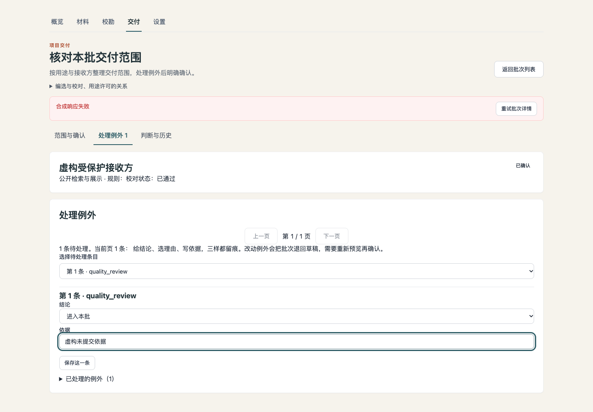
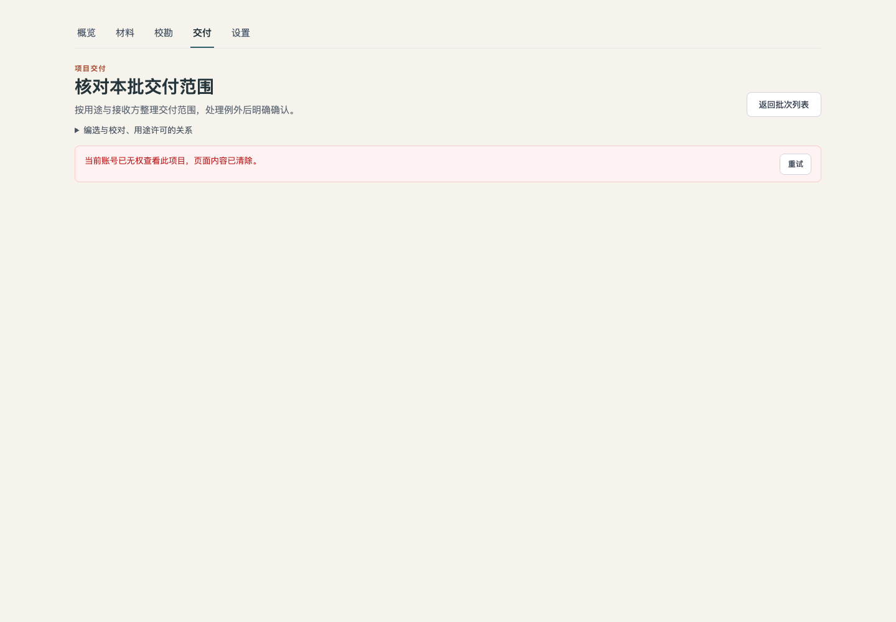
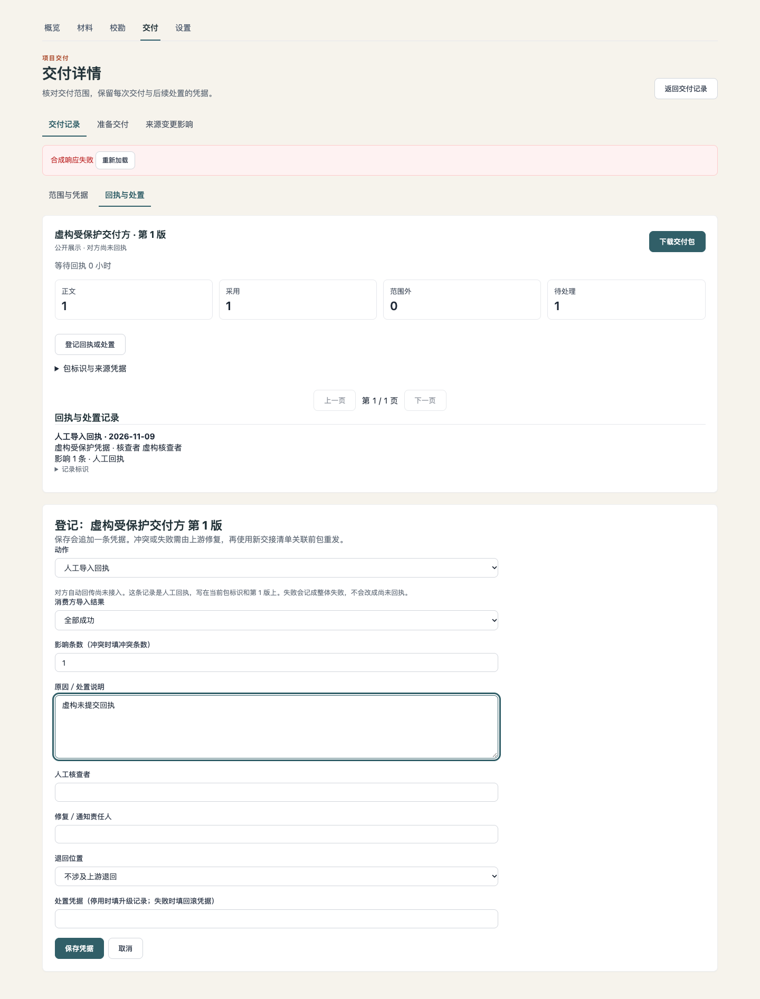
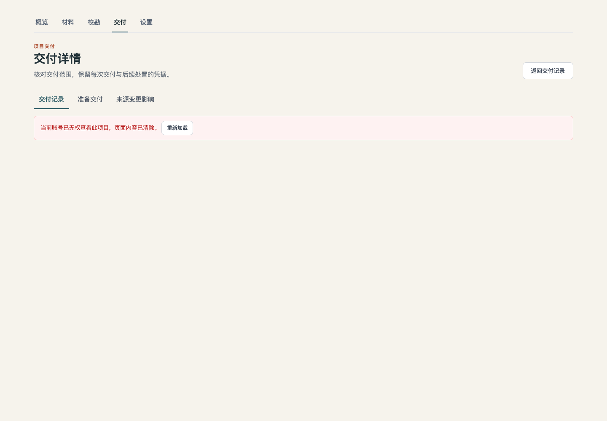
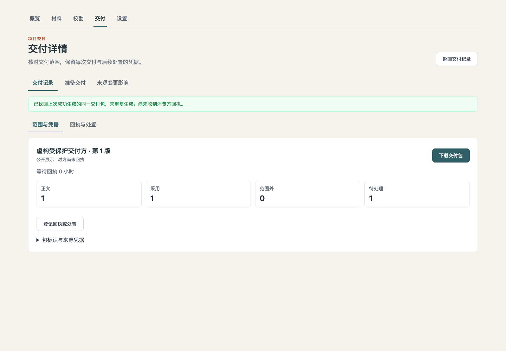

# 管理工作区访问失效清理（2026-11-09）

基线 `5f2251f5b7e9c3ef85a7c346a3cb49aa1112f555`；独立树实现，不涉及生产或真实资料。所有浏览器身份、接收方、例外、交付包、凭据及响应均为明确虚构的合成测试。浏览器挂载真实 Vue 页面、服务、路由和离页确认；受控 SDK 响应模拟权限变化，并故意忽略 abort 验证迟到响应。这里没有声称完成真实服务端撤权或全链路权限验收。

## 修复合同

- 两页所有读取、操作与选择器属于页面请求 scope。401/403 先取消请求、递增代际，再清受保护数据、表单、确认、预检和 UUID；身份／角色改变同样清理。正常 token refresh 保持页面；不注销其他会话，不清其他账号浏览器资料，不新增云草稿。
- 明确重试可以取得新 scope；只有当前请求成功才恢复操作。普通网络／500 错误保留最后成功的同对象内容与输入。取消 HTTP 只停止本页观察，不宣称已回滚服务端提交。
- 详情 404（或返回对象不属于当前项目）隐藏该对象及依赖表单，提供回列表／重试。编选详情只使用单批 GET 的记录，不再拿列表摘要当详情权威。URL 中的对象标识仅用于重试，不保留已失效对象正文。
- `WorkspaceLeaveGuard` 只增加可选 `bypass`，默认不变；业务页面决定失效。bypass 同步关闭挂起确认并结算导航，beforeunload 同样放行；它不决定权限、不替用户保存或提交。
- 交付下载保留 HTTP status，使用取消信号，并在创建文件链接前验证当前 scope，阻止失效后的迟到 blob 触发下载。
- 原生交付响应 `replayed=true` 显示“已找回上次成功生成的同一交付包，未重复生成；尚未收到消费方回执。”此响应提示不写回历史包。

## 证据与复现

原始截图与 JSON 位于 `output/playwright/admin-invalidation/`。旧版 mounted 复现：两页成功加载、输入未提交内容后收到 403，旧敏感详情与输入仍在。`before-results.json` 记录两项实际复现，`before-adoption-403.png` / `before-deliveries-403.png` 保留原问题。

```sh
# 如需重现旧版，先从固定基线生成仅供本地 fixture 导入的旧组件；不要提交旧副本：
git show 5f2251f:frontend/src/views/admin/AdoptionView.vue > frontend/tests/fixtures/AdminAdoptionBaseline.vue
git show 5f2251f:frontend/src/views/admin/DeliveriesView.vue > frontend/tests/fixtures/AdminDeliveriesBaseline.vue
# 在 frontend 启动仅localhost的Vite后执行：
ADMIN_INVALIDATION_BASELINE=1 NODE_PATH=/path/to/playwright/node_modules \
  node frontend/tests/browser/admin-invalidation.cjs
NODE_PATH=/path/to/playwright/node_modules node frontend/tests/browser/admin-invalidation.cjs
# 源码执行的生命周期/页面回归：
cd frontend
npm test
```

前端全量单测 578/578 通过，其中本包涉及的编选、交付、scope 专项 70/70。mounted 浏览器后验 16/16 通过，console errors 为空；生产构建与本包所有改动文件的 ESLint 通过。


修复后结果见 [after-results.json](after-results.json)，旧版复现见 [before-results.json](before-results.json)。本目录保留两页 403 前后截图及 replay 文案截图；完整 401/404、网络保留、guard 安全跳转、迟到 preflight 截图留在上述受控 output 目录。实际 after 覆盖两页各 500/401/403/404、挂起 guard 后身份清除、操作403、迟到预检/下载、下载403、A→B→A 以及重放反馈。第一轮 after 探针在下载403的文本定位上失败（alert包含“重新加载”按钮，exact文本不匹配）；改为等待页面真实 accessLost 状态并断言数据清空后，完整矩阵通过，未放宽行为断言。

独立审查还发现两条异步竞态并补回归：失效的旧交付加载不能在 await 后新建选择器请求；编选 A→B 后旧操作/导出取消，不能用 A 的迟到404清掉 B。单测使用不配合 abort 的 transport 验证代际检查，不把 cancel 当作唯一保障。






