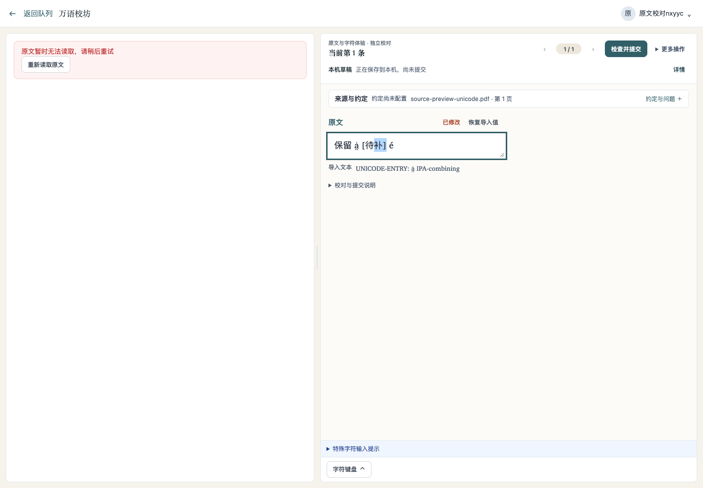
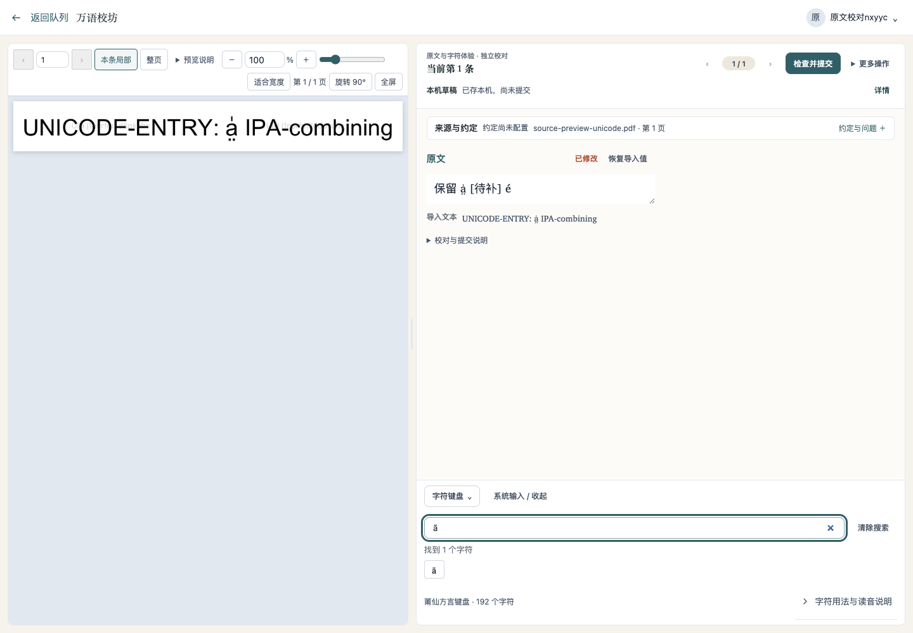
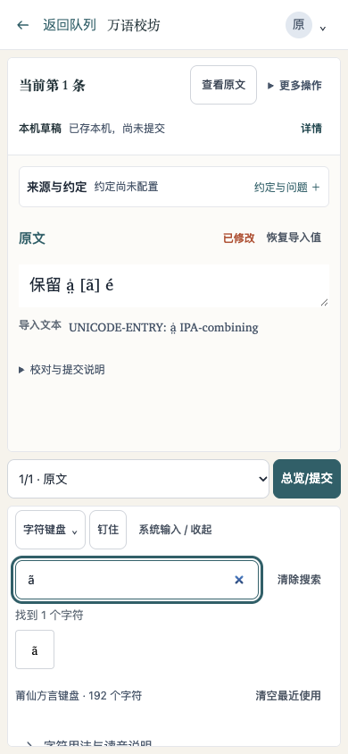
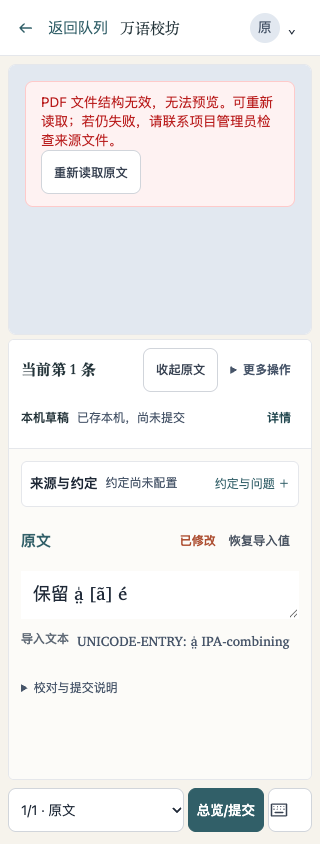

# 留在当前条目完成核对：原文重读与字符查找

2026-11-12。本轮继续完善逐条原文定位，同属 PR #436。使用隔离的本地后端、实际文字层提取 worker、Chromium 浏览器与临时账户；PDF、录入内容均为合成材料，没有生产数据或真人试用结果。

## 实际操作与结果

| 用户操作 | 观察到的结果 |
| --- | --- |
| 原文读取失败后继续填写，再点“重新读取原文” | 原文恢复为本条局部；同一个输入框的文字和选区均保持，焦点留在原文区域，恢复后重读按钮消失 |
| PDF 无法解析时重读 | 不再重复使用损坏的预览；恢复实际来源 PDF，显示正确文字。整页选择与第 1 物理页保持，原字段、选区及本机草稿不被重置 |
| 搜索 `ã`、`a＋组合鼻化符`、`U+00E3` | 三种查法均找到键盘原有的 `ã`。选中“待补”后点击该键，变为 `[ã]`，光标回到插入处；前后的 `a̤̍`、`é` 原码位保留 |
| 手机搜索字符 | 390px、320px 均无整页横向溢出，字符按键为 44 × 44px |
| 手机恢复原文后继续填字 | 重读按钮高 44px，在 320px、390px 首屏均可直接点到；恢复后阅读工具重新出现，可收起原文回到原字段 |

为进入失败状态，浏览器临时将一次原文描述请求改为 503，并另将页图请求改为 404、PDF 响应内容改为无效字节；恢复时撤销 PDF 或描述请求拦截，使用实际后端的授权原文。它们是受控故障走查，不代表真实服务曾发生这些故障。页图不可用时，恢复通过真实 PDF.js 渲染完成。

走查发现并当场修正了两处体验问题：PDF.js 的已知解析错误原先直接显示英文；320px 下，错误态阅读工具栏会把重读按钮挤出原文区域。现在明确的解析、密码保护、文件缺失错误使用中文说明；允许重读的非全屏错误态收起阅读工具栏，全屏仍保留退出入口。未知错误保留实际说明。

## 界面

### 失败时仍能继续填写

### 按输入习惯查找字符

### 手机字符搜索

### 最窄手机布局直接重读

## 必要核对与边界

既有字符查找、PDF 生命周期、缓存及两项原文读取检查共 12 项通过；相关文件 ESLint、格式检查、前端构建与 UI debt 通过。已尝试 `make check`，当前 Python 缺少 PyYAML，在入口退出，未记为全量通过。本轮没有新增后端协议或迁移。

本轮浏览器材料只有 1 个物理页，未重复此前多页定位走查；其他物理页的保留由既有原文读取检查覆盖。手机证据是浏览器视口检查，不是触屏真机或真人试用。输入中的合成修改未提交为校对结果。
