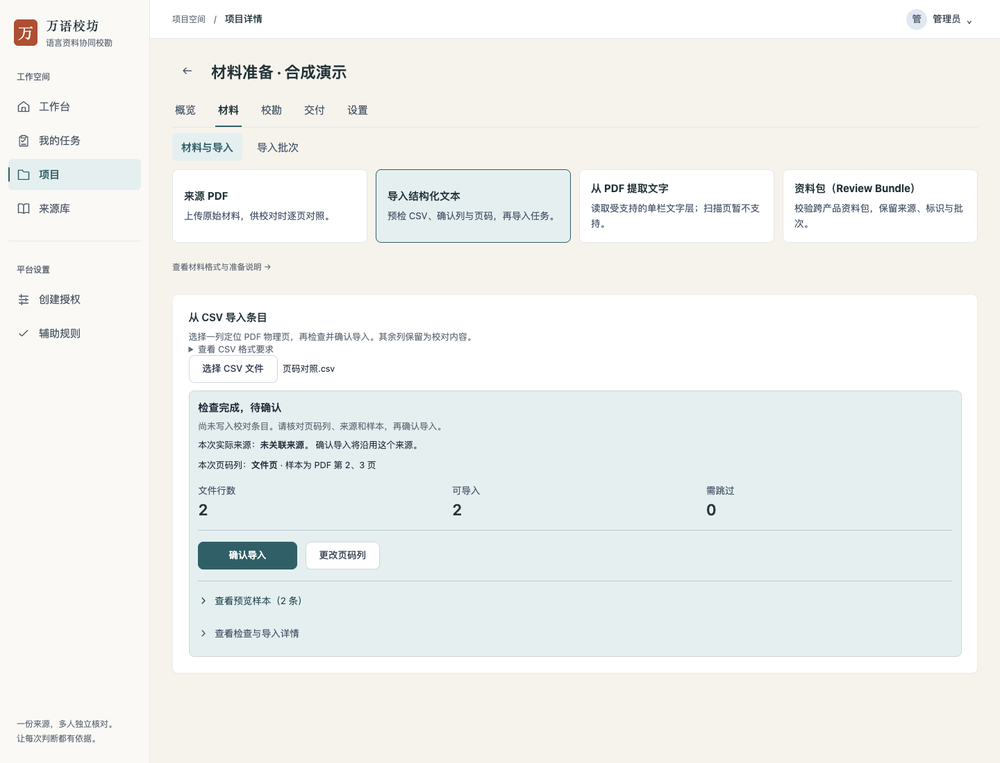
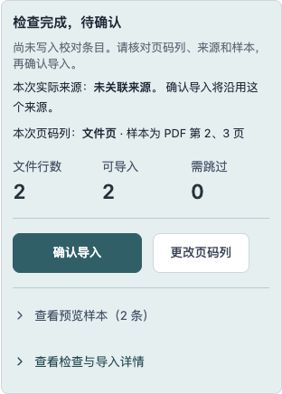
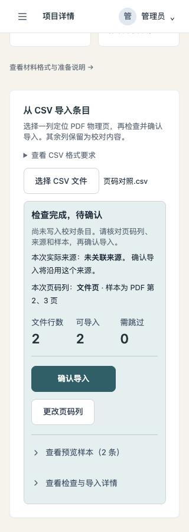
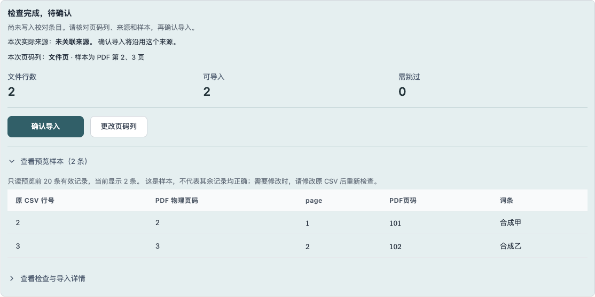
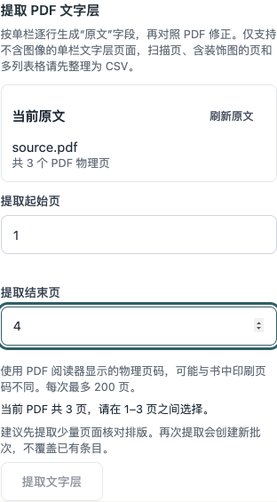

# 材料准备操作记录

日期：2026-11-12。隔离本地服务与真实浏览器，所有文件、账号和项目均为合成演示内容。没有使用生产语料，浏览器演练不代替真实用户验收。

## 已走通的流程

- 选择 CSV，服务器返回实际表头与原值样本。唯一常见页码列可以预选；同时有多个候选时不擅自选择。
- 同一文件更改页码列后，旧检查退出确认状态，必须重新预检。实际选择自定义“文件页”并确认后，入库条目的物理页为 2、3；原 `page`、`PDF页码` 两列仍作为内容保留。
- 预检表将所选页码展示在独立的“PDF 物理页码”列，不额外展示一个空白内容列；原表头大小写保持。
- 无主 PDF 时从文字层提取页进入上传；3 页 PDF 输入结束页 4 时，显示范围原因并禁止提交。
- 更换为 4 页主 PDF 后，切回提取页重新读取文件，提示核对页段。实际提交第 4 页，返回作业保存的文件标识与页面请求一致。

## 界面

保持纸墨配色、紧凑来源卡片和单一主要操作。桌面 1440px、手机 390px 与窄屏 320px 已检查。

## 检查与边界

前端相关检查、lint、构建和 UI 债务检查通过；CSV 导入接口、映射去重与错误定位、OCR 文件绑定和迁移往返已检查。

本轮只确认 PDF 选页与发起请求，没有演练 OCR worker 成功提取。没有新增扫描识别、自动分列或完整失败页清单，也没有进行真实语言质量评估。未运行本地完整 `make check`、容器与 Go race 检查，完整门禁由 CI 继续执行；未部署。
