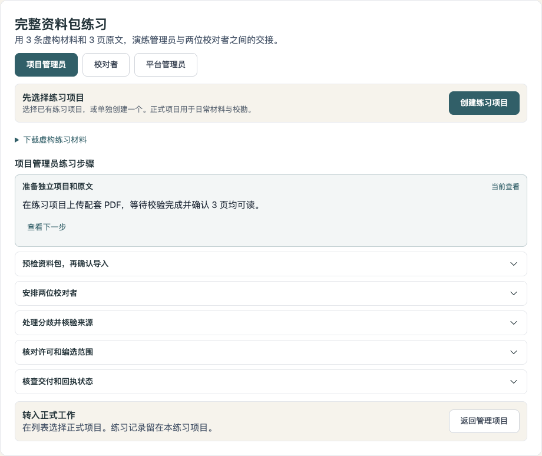
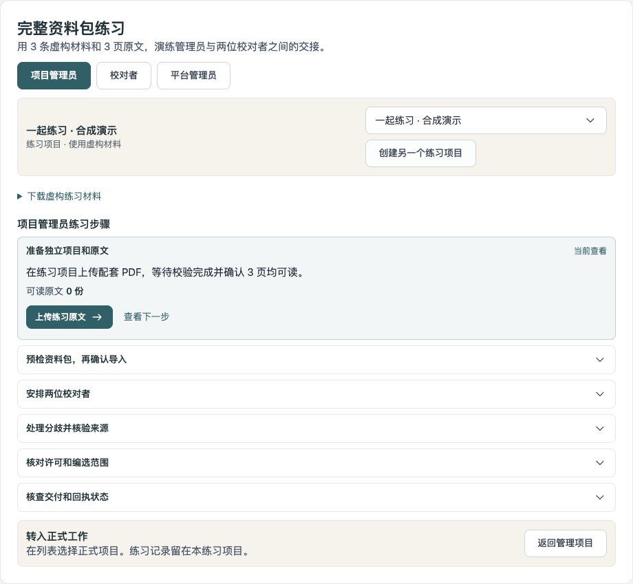
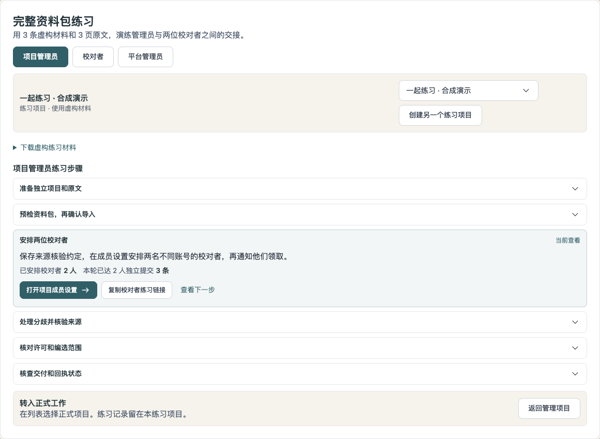
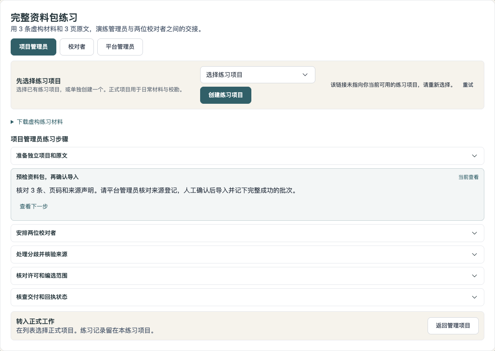
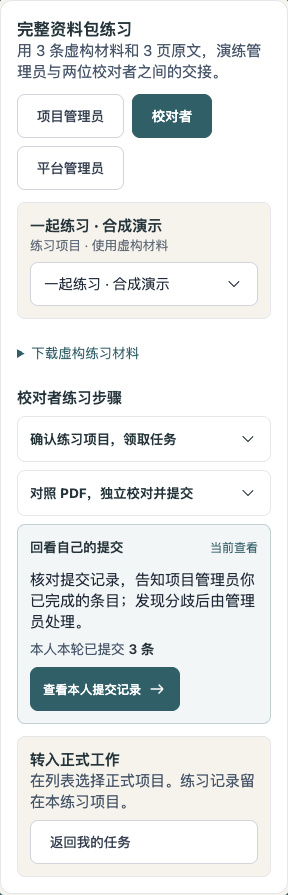
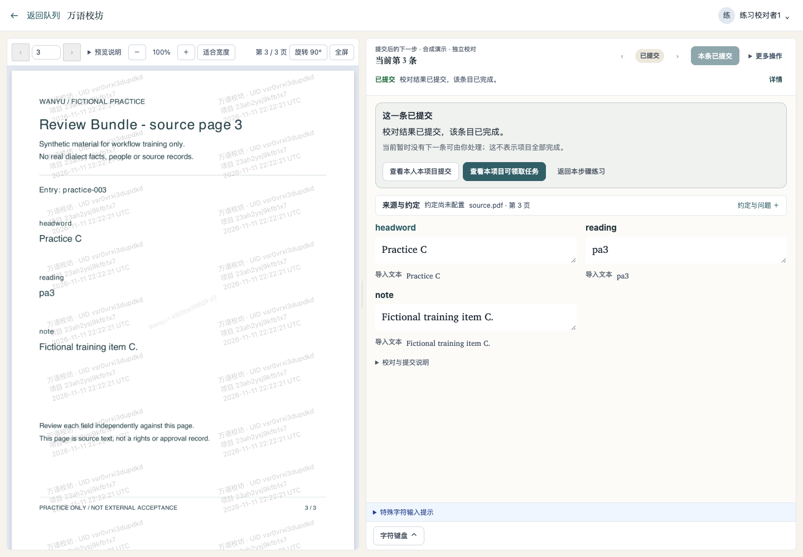
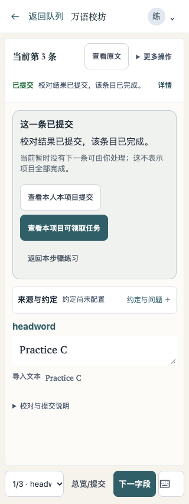

# 练习与任务续接操作记录

2026-11-12。在隔离本地服务与 Chrome 中操作，使用仓库自带虚构练习资料和演示账号；不含生产语料，不代表真人、专家或接收方验收。

## 实际操作

1. 从合成正式项目打开材料指南，练习区保持未绑定，不出现指向正式项目的上传或领任务链接。用创建表单另建练习项目后，恢复准备原文步骤。
2. 从步骤上传配套 PDF、检查并确认 3 条练习资料包导入、在成员表单添加两位演示校对者。逐次返回当前练习步骤；成员为 2 人时，独立提交仍显示 0 条。
3. 使用两个账号的实际领取和提交接口准备前序记录，再用校对者浏览器领取最后一条并提交。本人提交回看仅显示该项目记录，返回练习时显示本人当前轮已提交 3 条。
4. 在第二个独立练习项目重放最后一条：浏览器仅模拟一次后续领取失败，确认“返回原任务列表”保留原项目与视图，焦点落到失败提示；实际重试得到暂无下一条后，焦点转入已提交结果。原文继续显示，正常结束领取不再误报租约失效。这仅检查可见操作分支，不是可靠性验收。
5. 从项目交付二级导航进入编选、交付独立页面，以及平台来源库后，实际返回相应练习步骤。把正式项目 ID 填入练习参数时显示无法绑定，练习导入入口不出现。
6. 桌面、390px 与 320px 手机目检，320px 手机文档宽度为 320px，无整页横向溢出；项目绑定、步骤、实际数量与下一步按钮均可见。

## 界面

## 相关检查与边界

后端真实 HTTP 场景核对用途创建、旧值兼容、当前轮提交与有效领取、两人独立提交、角色范围，以及官方虚构练习包拒入正式项目。用途迁移往返和存在练习项目时拒绝删除标识通过；受影响队列检查、Go 构建、go vet、46 项迁移清单及往返检查通过。前端创建 9 项与提交/租约相关既有检查 25 项通过，lint、构建、UI 债务检查通过。

按仓库要求尝试 make check，因当前 Python 缺少 PyYAML，在静态守卫入口停止；未记为完整门禁通过。更新了既有资料包浏览器场景的旧勾选断言，但没有另跑该完整套件。本记录以上述实际页面操作为依据。

原 21 天方案的真人独立操作、真实语言质量及接收方验收仍待组织。没有合并或生产部署；不以练习记录证明学习合格或正式工作质量。
