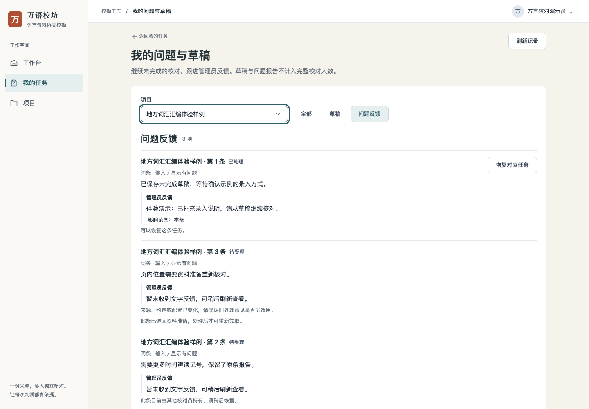
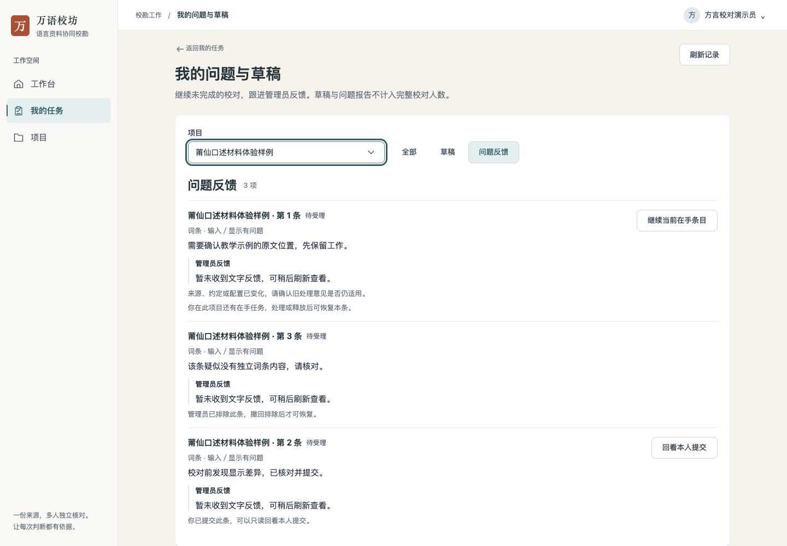
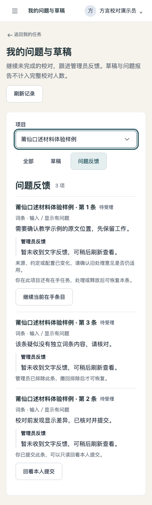

# 问题跟进与草稿继续：操作记录

2026-11-12。使用独立本地后端、真实业务接口、Chromium 浏览器与两个体验样例项目。账户、条目、草稿和管理员反馈均为合成数据；关联实际上传的合成 PDF，没有使用生产材料，也不代表真人或语言质量验收。

| 实际操作 | 观察结果 |
| --- | --- |
| 两个项目各有第 1 条 | 列表显示各自项目名，可按项目及草稿／反馈筛选 |
| 管理员更新反馈，校对员刷新 | 原行展示处理状态、文字反馈及影响范围；恢复操作与反馈相邻 |
| 恢复对应任务 | 实际恢复接口成功后进入正确条目；单次受控 409 的错误只显示在对应行，反馈保留 |
| 填写 `未完：a̤̍` → 释放 → 从问题列表恢复 | 返回原项目／反馈范围，合成文字及组合附标保持；再次进入显示继续在手入口 |
| 已提交项在新标签回看 | 输入区只读，观察到的业务写请求为 0；返回保留项目、反馈范围与大厅搜索 |
| 同条本人有效在手 | 当前标签继续时只续期，没有重复恢复或领取；独立新标签没有当前领取信息时不自动接手，显示明确说明，业务写请求为 0 |
| 排除、退回准备、他人持有、本人另有在手 | 分别显示实际原因或继续本人在手入口；排除记录没有恢复按钮。六类状态来自实际业务记录 |
| 最后返回我的任务 | 原来的“进行中”视图和项目搜索“体验样例”保持 |
| 手机 320px／390px | 无整页横向溢出；范围按钮均高 44px，行内动作按窄屏换行 |

本轮走查修正了返回列表时项目选择器停留在“所选项目”的问题：首次读取完成后再呈现真实项目名称，刷新保留现有选择器。重复恢复本人有效在手任务的问题由独立复核发现，修正后已核查原领取信息仍可续期及新标签不自动接手。

## 界面

[320px 布局](actions-mobile-320.png)亦已目视检查。

## 必要核对与边界

- 既有来源核验 HTTP 集成通过，包含可恢复、被排除、重复恢复不替换有效在手任务及原领取信息仍可续期；没有扩大恢复权限。
- 六项返回位置检查、一项既有领取响应检查通过；相关文件 lint、格式、前端构建、UI debt 与 diff 检查通过。
- `make check` 已尝试，本机 Python 缺少 PyYAML，在入口退出，未记为全量通过。既有来源核验浏览器脚本只适配了新操作名称与排除状态，并做语法检查；本轮浏览器证据为上述独立操作过程。
- 409 由浏览器临时拦截单次恢复请求产生，其余恢复、释放、反馈及回看使用实际接口。桌面与手机证据是自动操作浏览器，不是触屏真机或真人试用。
- 未完成合成文字没有提交为校对成果。列表中草稿与问题记录可指向同一条目；“已处理”只表示问题处理状态，不代表校对完成。
