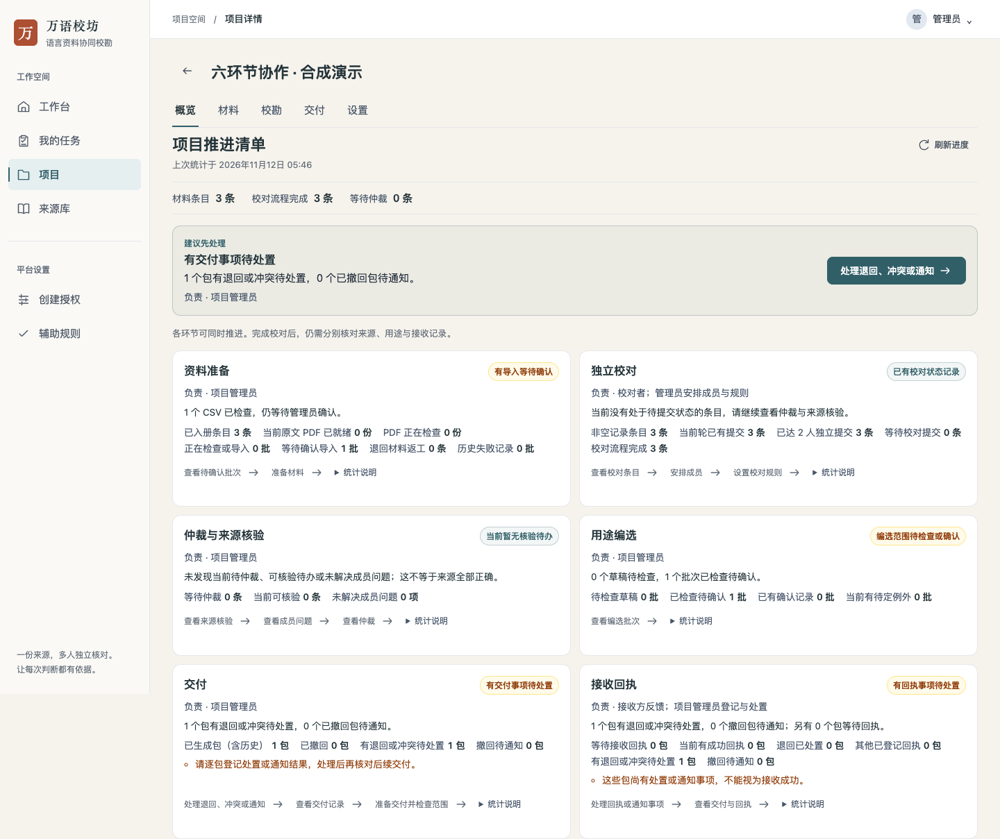
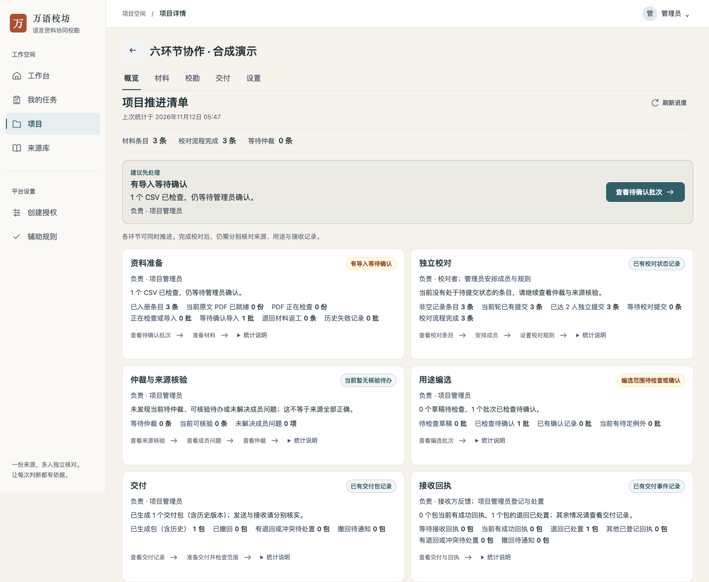
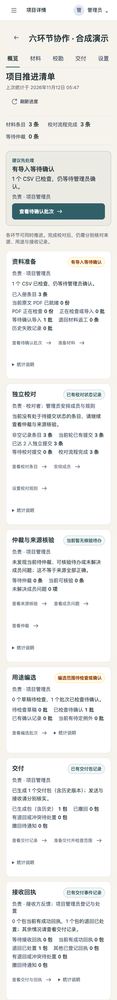
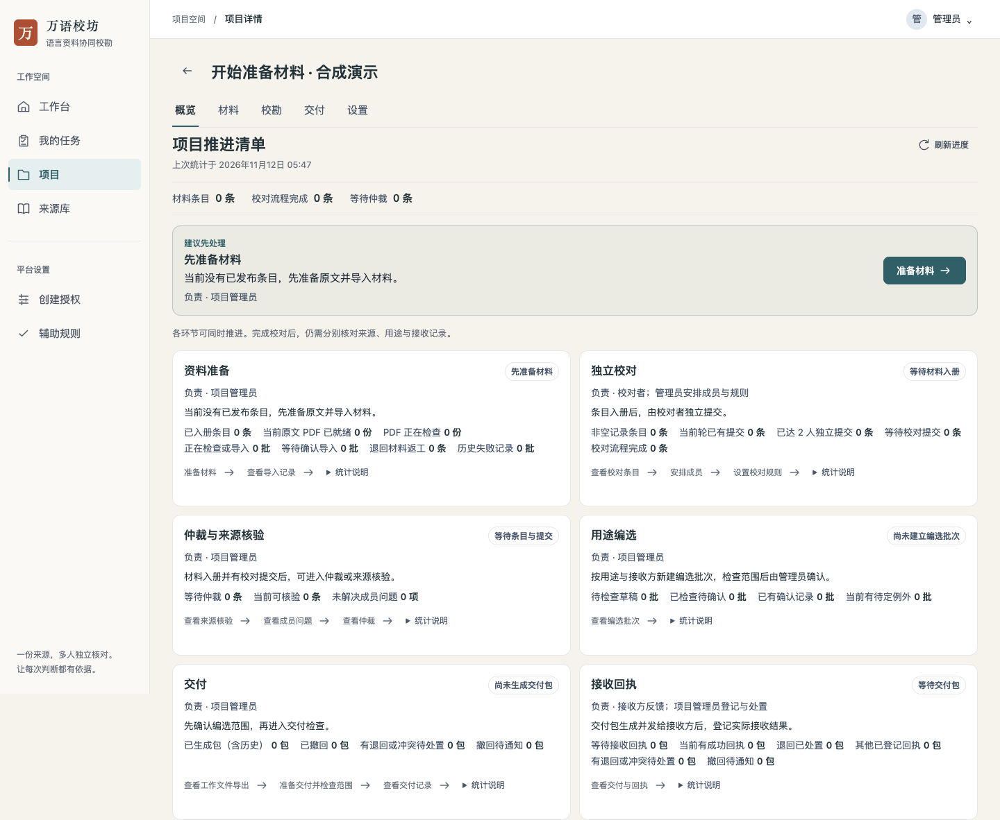
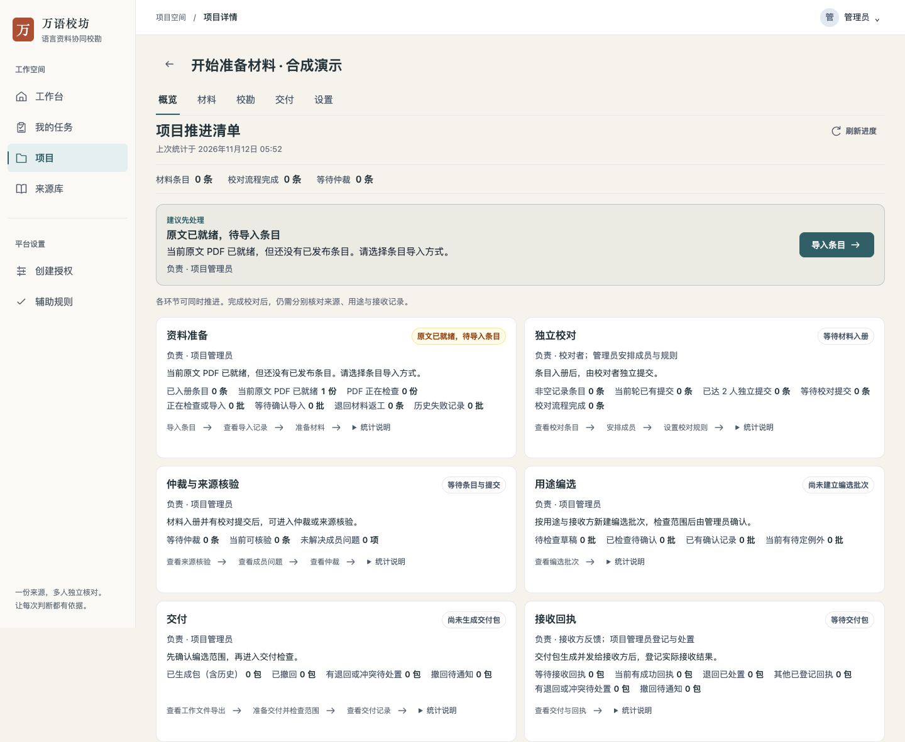
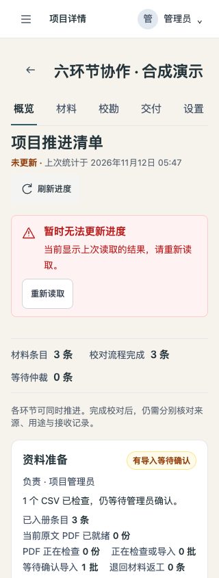

# 项目推进清单操作记录

日期：2026-11-12。使用隔离的本地后端、合成资料与 Chrome 实际页面。示例不含生产语料，所有校对与交付记录仅是开发演练，不代表真人、专家或接收方验收。

## 实际走过的路径

1. 通过原有接口导入 3 条合成资料包条目，由两个独立演示账号领取并提交；其中一条产生分歧后由演示管理员仲裁。三条均完成校对流程。
2. 实际生成包含这 3 条的交付包，另建一个已预览未确认的编选批次，以及一份待确认的 CSV。概览同时呈现这些事实：校对完成不掩盖材料待确认、编选待确认和接收回执未返回。
3. 点击概览进入成员、校对规则、编选和指定交付包；成员与规则分别打开正确页面，待回执入口直接定位到该包的回执与处置页。
4. 在真实表单中登记合成退回，概览优先提示交付待处置。再从建议入口登记处置完成，概览显示“退回已处置 1 包”，成功回执与等待回执仍为 0。
5. 空项目提供准备材料入口。上传示例 PDF 完成实际校验后，概览提示原文已就绪，下一步直接进入条目导入。
6. 320px、390px 与桌面查看布局。320px 页面宽度等于视口，无整页横向溢出；长说明默认收起，操作保留触控高度。
7. 仅在浏览器中模拟一次汇总请求中断：六张已读取卡片保留，显示“未更新”和上次时间，旧优先建议撤下；恢复请求后可重新读取。此项仅验证该可见状态，不是可靠性验收。

## 界面

## 相关检查与边界

针对性 HTTP 检查覆盖权限范围、暂存条目不计入册、当前轮实际独立提交、退回处置与接收的区别，以及某环节读取失败时的未知状态。后端构建与 go vet、前端 lint、构建和 UI 债务检查通过。

已尝试 `make check`，因本机 Python 缺少 PyYAML 在仓库静态守卫入口停止；未宣称完整门禁通过。未执行完整容器与 Go race 套件，无迁移和生产部署。

原 21 天方案中 5 人参与、4 人独立完成、管理员 1 分钟内解释阻塞，以及真实材料质量和接收方验收仍待组织。本演练不会替代这些证据。
