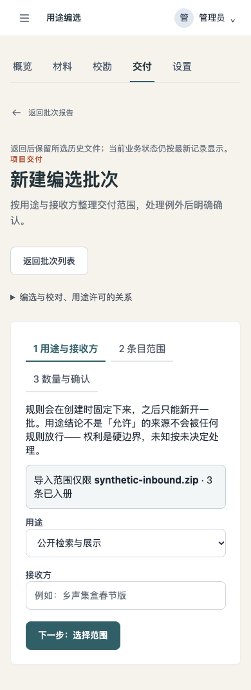
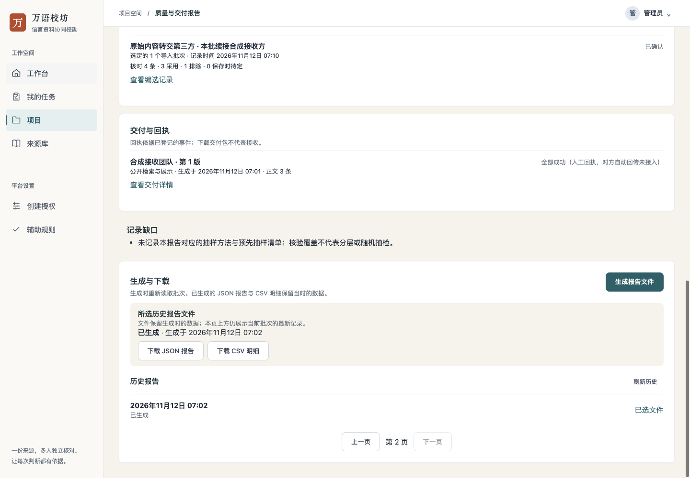
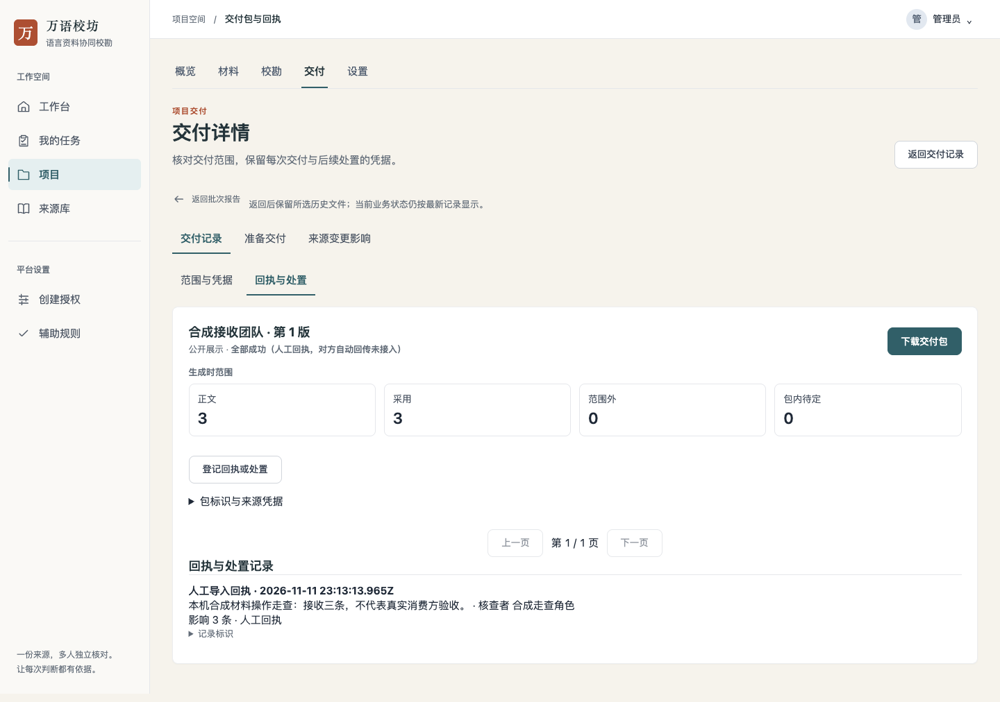
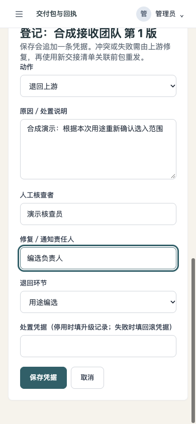
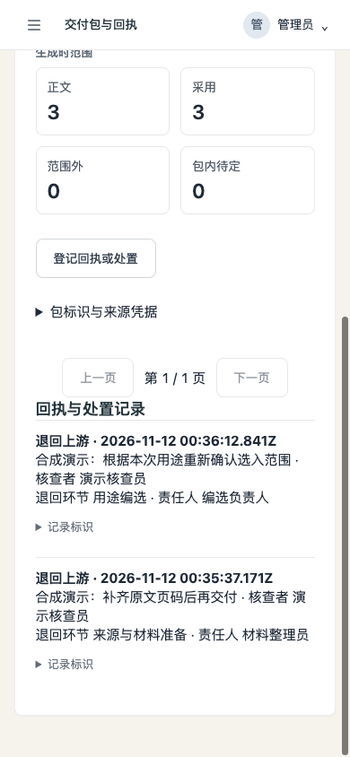
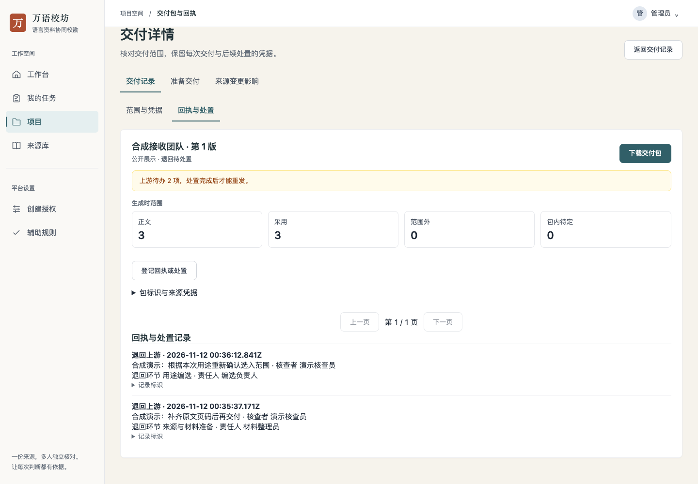

# 批次报告操作续接：本机合成走查

日期：2026-11-12。使用本机隔离后端和浏览器，全部条目、账号、接收方和回执均为合成数据。以下是 AI 操作证据，不代表真人试用、真实资料授权或消费方验收。

## 实际走过的路径

- 同项目导入两批材料：资料包 3 条、另一份 CSV 1 条；生成 9 份历史报告，选中第 2 页的文件。
- 报告 → 为本批新建编选：显示文件名及 3 条入册数量；未改动自动带入的表单时直接返回，不触发未保存提醒。
- 实际创建、预览、确认编选，再进入交付准备。后端保存的 `rule.importJobs` 仅含原资料包批次；统计为项目 4 条、进入本批 3 条、已定不进入 1 条，排除理由为其他导入批次。另一个 CSV 没有混入选入范围。
- 同用途已有未确认编选时，实际收到 409 并显示“查看已有未确认编选”。点击后出现未保存确认；取消继续填写，确认后进入原记录。原记录仍是原来的全项目规则和历史数量。
- 报告 → 登记本包回执：直达对应包的“回执与处置”，主动打开表单、填写并保存合成回执。返回报告时当前等待回执从 1 包变为 0 包；下载所选旧 JSON 后，旧文件仍为等待回执状态。
- 编选、交付准备、项目设置及项目交付二级导航的返回入口保留历史文件与历史页码。当前报告与历史文件文案明确分开。
- 报告 → 本批待仲裁列表：保留原导入批次条件，显示 0 条待仲裁，且只有一个“返回批次报告”入口。此场景没有新增真实仲裁任务。
- 历史列表第 2 页 → 第 1 页 → 第 2 页，所选文件不变；返回台账使用原批次行锚点。
- 390px 与 320px 的新建编选页面无文档横向溢出；人工查看了桌面和手机截图。未创建大量合成交付包来模拟多页交付列表，该分支经过代码复核，仍待真实使用场景观察。

## 界面

## 必要检查与限制

前端 lint、构建、变动文件格式、UI debt 和差异检查通过；相关现有检查 75 项通过。后端现有代码构建成功，用于本次真实接口操作；首次续接实现无后端或迁移变更；下述中文环节名称补充只调整后端人读提示。浏览器控制台的 409 来自上述同用途未确认编选场景。

尝试 `make check`，在起始静态检查因本机缺少 PyYAML 停止；未把完整仓库门禁记为通过。没有新增专用测试套件，既有函数提取夹具与页面定位仅随本次改动适配。

未执行合并或部署。真实使用者的流畅度、美观度反馈与接收方验收仍由相应人员完成。

## 中文环节名称补充

交付表单和历史记录共用「来源与材料准备」「校对与仲裁」「拼音整理与复核」「用途编选」「交付与回执」名称。现有退回操作只提供实际支持的两个环节：来源与材料准备、用途编选。界面不显示内部字母，历史凭据及接口值不变。

在新的隔离服务和合成项目中，实际完成两次退回登记并刷新页面，历史仍显示与表单一致的中文环节及责任人。漏选环节时，后端提示应选择的业务环节，原输入保留；控制台的一次 400 来自这次故意遗漏。390px 截图可见完整名称，320px、390px 和1440px 均无文档横向溢出。仅审查了这些实际支持的退回路径，没有伪造其他环节的业务事件。

本次前端 lint、构建、既有交付页面检查 32 项、变动组件格式、UI debt、后端构建及现有交付分页检查通过。再次尝试 `make check`，仍因缺少 PyYAML 在起始检查停止。无新增测试套件、无迁移或权限变更。

