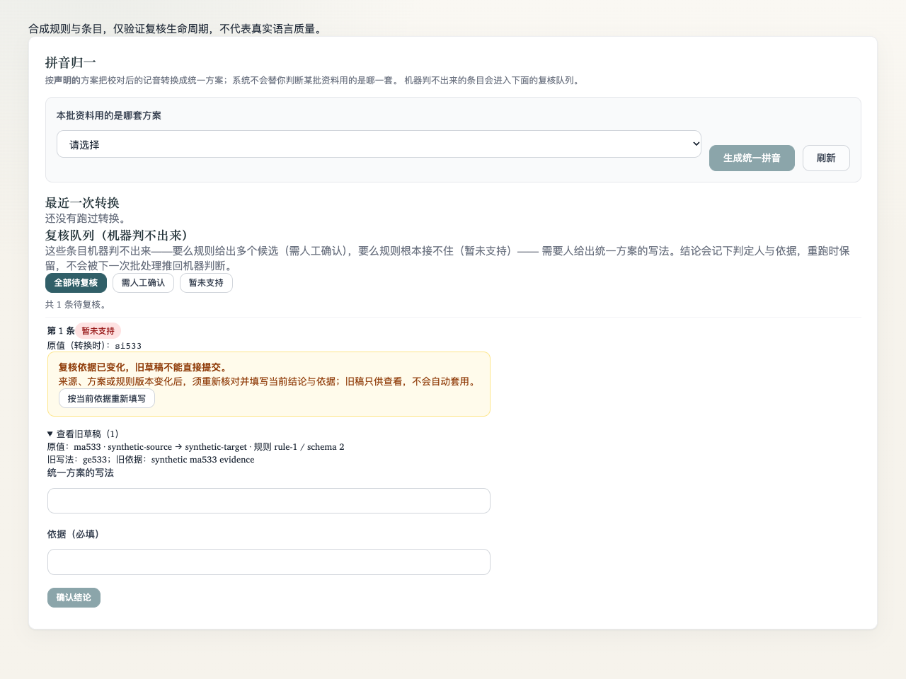
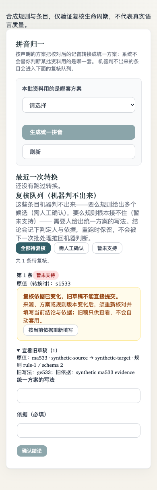

# PR #387 归一复核草稿依据修复

回应 [P2 评审](https://github.com/e-dialect/wanyu-proofreader/pull/387#discussion_r4499998468)。原 `a36d1c2` 按 row.id 保留输入，把 `ma533` 的 `ge533`/旧人工依据留在重跑后的 `si533` 旁，服务端也没有条件提交护栏。

[基线复现](baseline-reproduction.json) 实际执行 `git show a36d1c2:frontend/src/components/admin/project/ProjectSchemePanel.vue` 中的 `loadReviews` / `saveReview`：两次成功列表返回后，旧控制器确实发送 `ge533` 与针对 `ma533` 的依据。新控制器在同一合成输入下清空当前表单、只读保留旧稿并零发送。不是缺少新 import/helper 的异常反证。

## 修复与测试

- 服务器 GET 返回完整复核凭据；POST 同一写事务内重新读取业务上下文并校验，缺失/变化409零写入。绑定当前读音与转换快照、reading列/角色、源/目标方案、规则/schema、从同一份载入字节产生的确定性source/target文档摘要、产物与来源文件快照。无PDF是合法明确状态，查库失败不是absence。无关 updated/质量/租约不使草稿失效。
- 队列批量读取关联文件及主PDF，固定最多2查，不增加逐行查询；单条POST在事务读取对应来源快照。worker也在每条写事务内重读，旧批次页不能覆盖后来人工REVIEWED。
- 前端同依据保留；依据变化时旧稿只读归档，新表单锁定并要求显式重新填写。409后成功重新GET之前保持锁定；刷新失败不能把旧来源称作当前依据。离页或移出队列草稿有工作区只读入口，不宣称持久化。
- 定向Go6项（含空串/纯空白子例）通过；最终同组 `-race -cover` 也通过（32.986s，选择性主包覆盖率5.3%，不是全仓覆盖率）：来源变更/缺凭据/GET→POST变化409；无关变动不失配；实体PDF出现与同ID文件hash替换、DB错误；确定性规则摘要；先读批次→人工提交→旧批次执行的保护与skipped计数；明确人工空串/纯空白使旧凭据409，当前视图标来源变化，转换计skipped且不回用OCR。
- 新Node7项加原14项通过：同依据保留、不同依据失配、重新填写、离页保留、409移出队列可见、迟到保存不污染、409刷新失败持续锁定。
- 实际挂载真实 `ProjectSchemePanel` 的浏览器5/5通过（全部API显式合成）：同依据刷新、变来源锁定旧稿、保存前再次变化409、新依据重新填写、移出队列只读查看；[请求结果](report.json)。1280和390截图已视觉核对，390无整页横向溢出。脚本接入既有统一mounted runner `repository` 组。
- ESLint、touched Prettier、UI债务和diff空白检查通过；总体验证由根任务继续汇总，不提前声称最终CI通过。

规则、输入与手工依据均为合成夹具，仅证明生命周期/一致性，不代表真实方言转换、人工判断或语料质量。无迁移，无人工语言规则改动；前后端条件提交兼容边界见 [API契约](../../../scheme-normalization-review.md)。
