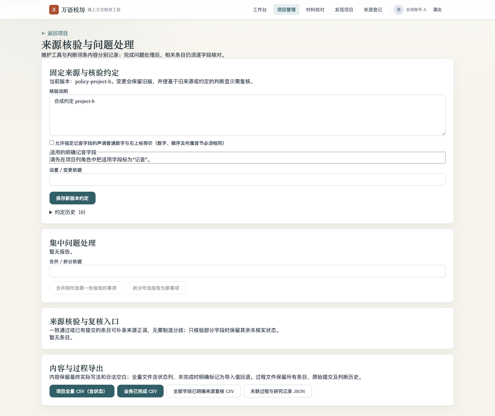
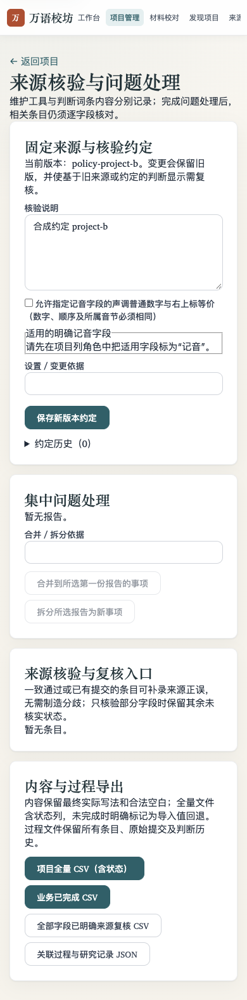
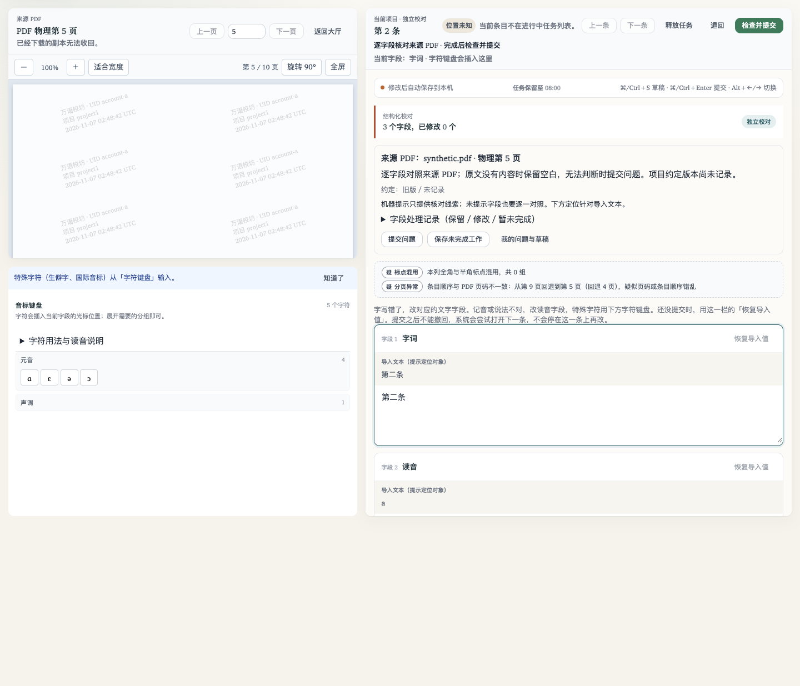
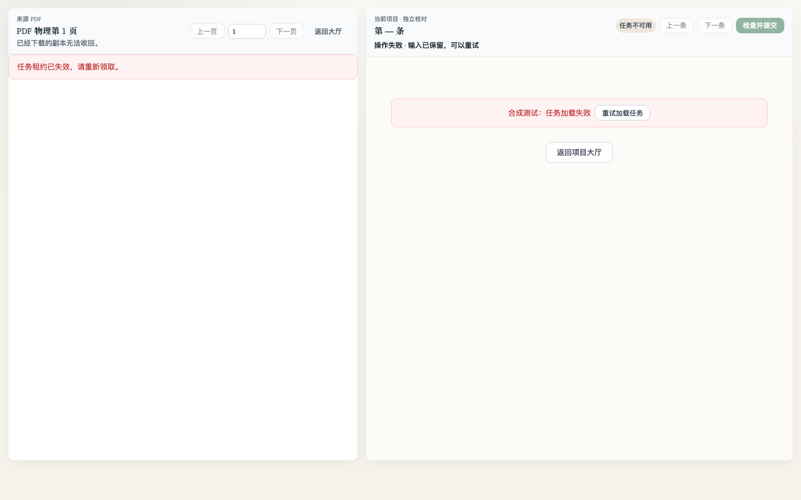
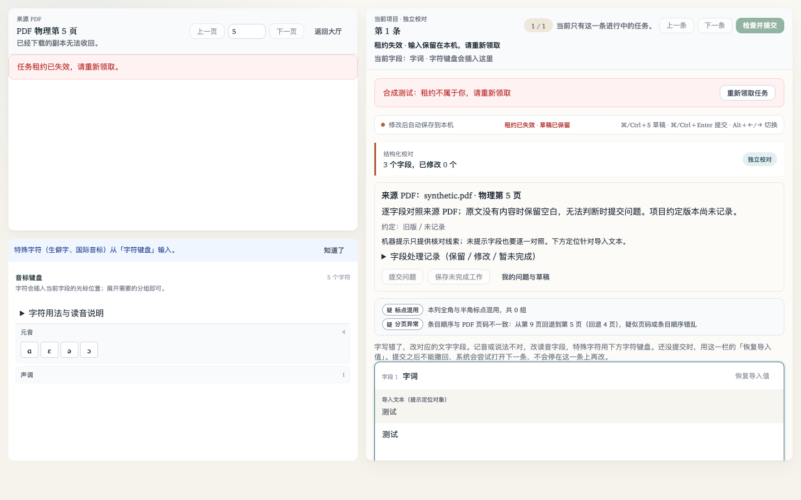

# 前端仓库审查与回归（2026-11-07）

基线为合并 #386 后的 `5afa6fc9156183931dce1280e2e997f4df1148b5`。下列为实际源码审查与自动化证据；不把有限检查称为全部缺陷已穷尽，不替代真人试用、真机输入法或语言质量验收。

## 已确认并修复

| 范围 | 可触发的旧行为 | 当前行为 / 回归 |
| --- | --- | --- |
| 管理路由 | 来源核验、交付等捕获首次项目 ID，同组件切项目后仍操作旧项目 | `adminRouteKey` 以项目/仲裁条目隔离实例，query-only 分页保留实例；真实来源页 A→B 挂载通过 |
| 项目设置 | 旧项目保存迟到可覆盖新项目资料；成员变更后续读取可在新项目执行 | 发起时固定 ID，写回、后续请求与导航前检查当前挂载项目；卸载使加载代际失效 |
| 鉴权状态 | `isLoggedIn` 没有响应式依赖；跨账号保留旧权限上下文、共享请求或已挂载私有页面 | token 驱动 getter；换身份清缓存/请求，受保护页面按账号重建；退出及强制改密重走 guard |
| 异步凭据 | 外部绑定/SDK 刷新等响应可在退出、换账号或同账号换 token 后恢复旧凭据 | 同一 REST 契约，短期会话观察器限定发布；过时结果以 AbortError 终止，不返回给 store 重放 |
| 最后输入 | 校对同组件切条时先取消 500ms debounce，最后输入没有落盘 | 用户确认离开后立即 flush，再允许路由更新；真浏览器保留 `𠮷 a̤̍⁵³³ 最后500毫秒输入` |
| 不兼容旧草稿 | 未编辑当前原文就离开会删除唯一旧草稿；重复 context 读取可再次覆盖新输入 | 清除当前键前归档旧值，归档失败保留原键并提示；失配恢复只处理一次 |
| 核验面板 | 旧问题响应可写入新条目的报告；旧保存失败污染新错误；卸载读取仍发布 | 读取、排队写入、报告回调与卸载使用代际检查；旧队列未发出时直接丢弃 |
| 租约计时器 | 旧续期响应在切条/卸载后又开启 interval | 恢复流程 await 后确认仍属当前 case，再启动续期 |
| PDF 回退 | 图片不可用而使用 PDF 时没装 expiry timer，超过授权窗口不重验 | PDF 与图片都按缓存授权到期时间重新读取 descriptor |
| 归一复核 | 慢旧筛选覆盖新清单；刷新会清空同条目人工填写 | 最后查询响应才可发布，同 ID 草稿保留；卸载与轮询 await 后复查代际 |
| 仲裁说明 | 保存进度中继续编辑 note，旧请求返回把新 note 标成已保存 | `lastSavedNote` 只记录发起请求时提交的 note，之后输入继续触发离开确认 |
| OCR 台账 | 物理页与输入行混加，入册行数被当作处理页数 | 后端配套 `count_unit`、`summary.ocr_pages`；前端分别列页/行，inserted_count 始终是入册行 |

## 检查覆盖与边界

- 身份、注册、外部绑定、资料与首次改密：检查 `authService` / store / Login / Register / Profile / ChangeInitialPassword、路由 guard 与站内 redirect；会话竞态已修。注册校验、密码规则和原有站内 URL 过滤未发现新的可确认缺陷。
- 工作台、项目发现、任务大厅、个人面板与分页：检查服务查询参数、pending/error/empty、分页和用户作用域；沿用原异步资源/游标与服务端权限，未发现额外确定的分页或跨盲校结果泄漏。
- 校对、本人只读、租约、草稿和提交/退回：检查任务代际、路由更新、自动保存、服务端草稿、提交快照与租约恢复；上表缺陷已修。只读回看没有新增 claim/draft/submit 写入，提交/退回错误恢复与字段值保真沿用既有测试。
- 项目管理、成员候选、导入/OCR、条目与质量状态：检查项目作用域、候选分页、表单保存和晚到响应；上表设置/路由/台账已修，OCR 请求意图持久化、质量弹窗快照与条目分页接口没有发现新增确定缺陷。
- 来源、规则门控、编选与交付：检查项目捕获、请求目标、来源权限和人工判断语义；管理路由隔离、仲裁说明快照已修。既有权利门闩仍由服务端决定，未扩大用途或把未核实状态记为正确。
- 助校疑点、归一、键盘、字体与来源 PDF：检查只读提示、定位码位、字段选区、字体失败重试与缓存有效期；归一/缓存缺陷已修。192键及未知读音边界不变，不以 Unicode 名称推定方言读法。

## 实际验证

- `frontend/tests/repositoryFrontendRegression.test.js`：14 个执行生产控制器/服务函数的回归全部通过。将读取对象替换为 `git show 5afa6fc:<path>` 后，同一组 14 个断言全部失败，0 cancelled，见 [基线摘要](baseline-regression.txt)。SDK stub仅复现其原有“响应先写入 authStore 再 resolve”的语义。
- 全前端 `npm --prefix frontend test`：399/399 通过（包括根审查任务另加的 2 项离线评分回归）。ESLint 与 UI 债务棘轮通过。
- 真浏览器挂载真实 App、AdminLayout、来源核验与校对编辑器，API 为显式合成拦截：项目 A→B、快速切条保留草稿、跨账号重新读取、退出清私有视图、真实 Login 登录后保留原 redirect，5/5 通过，见 [请求记录](browser-report.json)。
- 另跑既有 `editor-states.cjs`，正常、空、503 错误后重试、租约禁用四态全部通过。正常/错误/禁用与390px截图已视觉核对，窄屏页面无横向溢出。
- 新脚本已接 `backend/tests/run_frontend_quality_browser.py`，不是孤立入口：`--only repository` 可单跑，CI 既有全量 mounted job 自动覆盖。

## 截图

其余 [正常](editor-normal.png) / [空](editor-empty.png)。嵌入的 PDF、账号、词条与约定均为合成材料；截图中的空 PDF/水印不是实际语料识别或来源质量证明。
