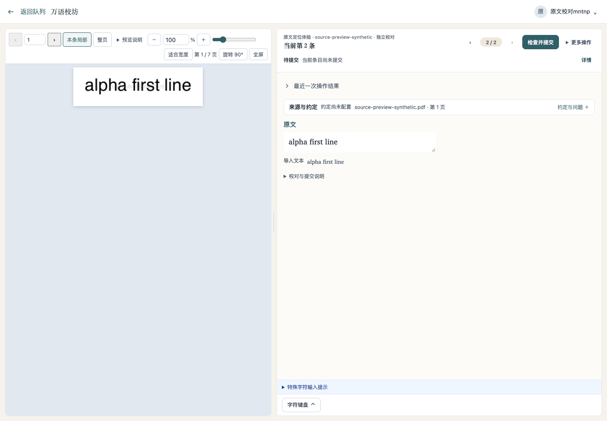
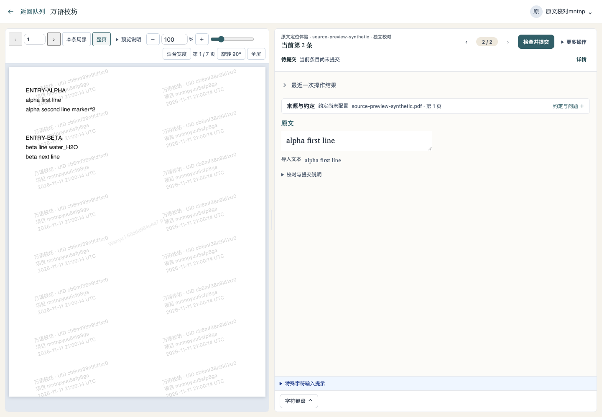
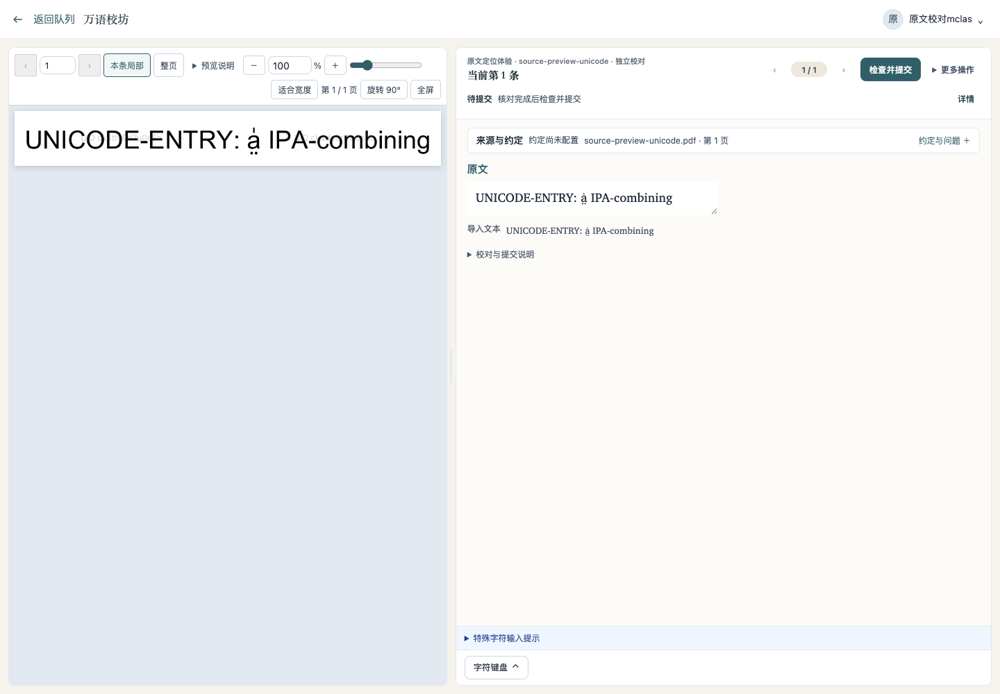
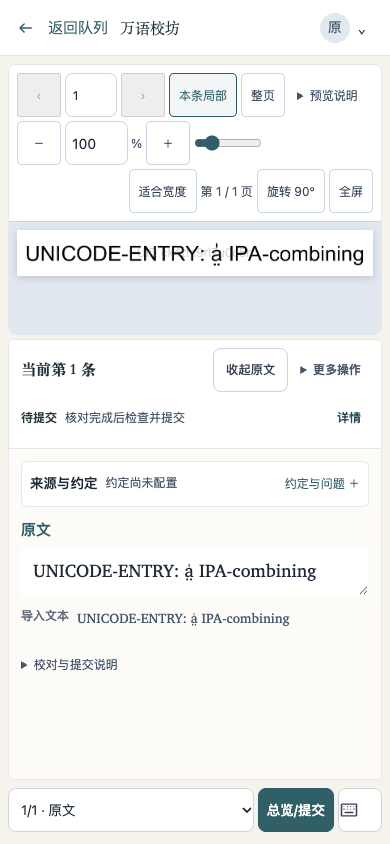
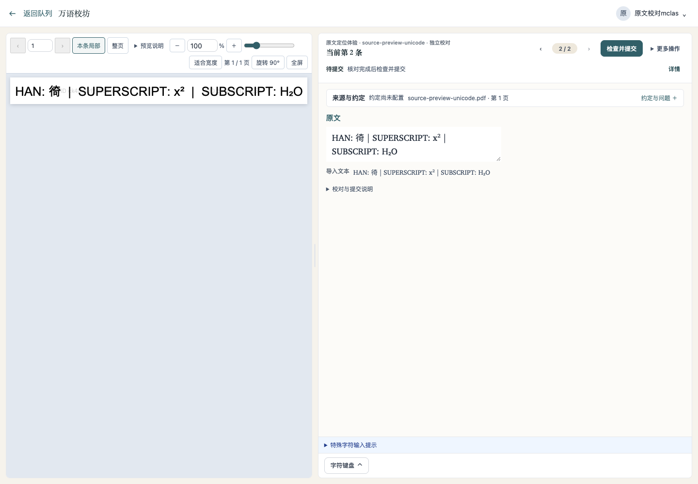

# 逐条原文定位：操作与界面核查

日期：2026-11-12。使用独立本地数据目录、实际后端、实际 Poppler 文字层提取 worker，以及 Chrome / Edge 中的 Vue 页面。全部文字与账户都是合成样例；没有使用生产语料或真人校对结果。

## 已实际走通

| 使用情形 | 观察到的结果 |
| --- | --- |
| 上传 7 页 PDF → 提取 → 领取 → 打开原文 | 生成 20 条实际记录。单栏条目有与本条绑定的局部框；双栏页的 4 条记录均返回整页 |
| 同页连续校对 | 在页面确认提交第一条，自动进入第二条；原文由 `ENTRY-ALPHA` 更新为 `alpha first line`，没有沿用上一条位置 |
| 查看上下文 | “整页”显示当前来源页；“本条局部”返回该条位置。查看下一物理页时为整页，再点“本条局部”回到本条所在页 |
| 字形完整性 | 实际提取另一个含 `a̤̍`、`é`、“徛”、`x²`、`H₂O` 的 PDF；局部四边有留白，组合附标和上下标可见 |
| 手机 | 在 320px、390px 视口展开原文、切换范围，无页面横向溢出；切换按钮至少 44px。附图为 390px |
| 页图不可用 | 只将图片请求返回 404，保留实际后端 PDF 与定位响应头；受保护 PDF 回退仍显示第二条的正确局部，未截字 |
| 无权读取或改写 | 其他项目的读者读取本条预览返回 403；普通项目管理员经记录 API 改写定位或原始行框返回 403，数据库原值保留 |

初次真实导入发现隐藏定位字段被表单加载忽略，导致所有条目回整页；已改为服务端显式保存，并重新完成上述上传、提取和显示过程。另在目视走查中修正了范围按钮的默认浏览器外观，使其与现有工具栏保持一致。

## 截图

### 同页下一条直接定位

### 当前条目的整页上下文

### 真实组合附标的局部

### 手机原文展开

### 图片不可用时的 PDF 局部

## 必要代码核对

- 实际 PDF 的 0°/90°/180°/270°、非零 MediaBox/CropBox、双栏与大词间隙采用已有 Poppler 和 pdfcpu 解析验证；可复现样例位于 `backend/ocrengine/testdata/`。这些几何核对不等于四种方向均已由真人在设备上验收。
- `go test . ./ocrengine -run '^(TestStartOCR|TestProcessOCR|TestOCR|TestSourceRegion|TestNativeBoundingBox|TestImagePreflight)' -count=1` 通过，包含实际发起提取入口、旧 worker 兼容与新增迁移往返。迁移检查保留原文字段，不声称完成全部迁移舰队往返。
- 前端 Node、lint、构建、UI debt 与既有 PDF 浏览器生命周期检查通过；包括同条续签保持阅读状态、没有定位的旧条目保留原有整页行为。
- 已尝试仓库的 `make check`；当前 Python 缺少 PyYAML，在入口检查时退出，未把它记为全量通过。没有运行镜像构建、生产部署或全量 race。

## 后续由实际材料确认

上述结果证明合成材料上的操作链路和显示效果。原书字体、复杂附标、窄字形、连续释义和多栏材料的阅读效率仍需授权材料试用；本轮不提供定位准确率、节省时间或真实语言质量的量化承诺。

现有文字层提取按物理行生成记录。样例的连续多行是多条记录，不能作为自动合并多行词条的证据。CSV 和历史导入继续整页查看，手动框选与扫描材料定位不在本轮范围。
