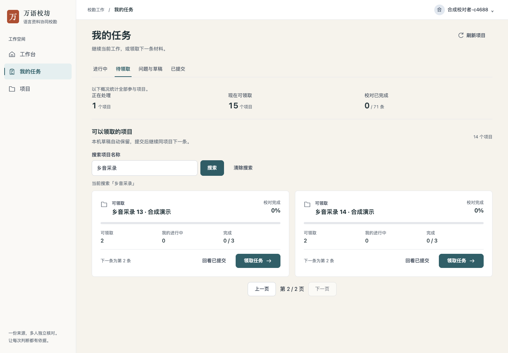
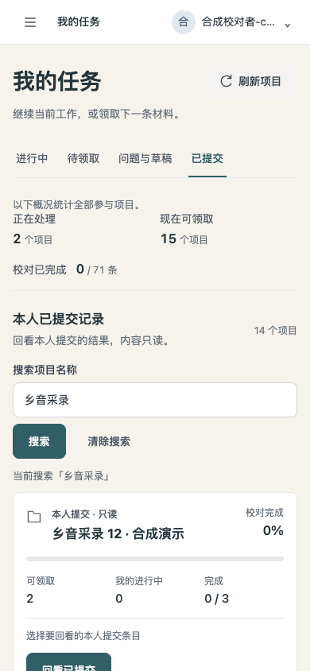
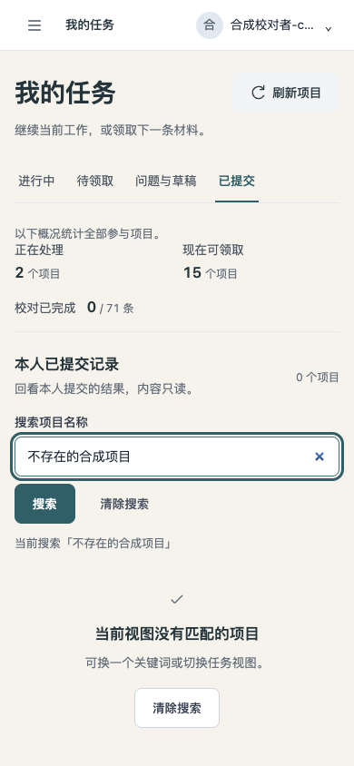

# 任务项目搜索：本机操作记录

2026-11-12，在隔离后端和真实浏览器中使用合成账号、项目与条目。以下是 AI 操作记录，不代表真实校对者试用或语言内容验收。

## 实际走查

- 准备 15 个参与项目，其中 14 个名称含「乡音采录」；另有一个同名片段的未参与项目。每页12项，目标项目原先不在第一页。
- 搜索「乡音采录」显示14个项目，翻到第二页可看到第13、14个；顶部概况仍是全部15个参与项目，未参与项目未进入结果。
- 从第二页领取第14个项目的任务，编辑链接带搜索和页码；刷新后点击返回，仍在待领取视图第二页且搜索框保留原词。复制该编辑链接到新标签，同样得到明确的返回目标。
- 切换已提交视图保留搜索并回第一页；再从第二页进入第13个项目的本人提交目录，按条目号1定位、进入只读回看、刷新、返回目录，再返回大厅。条目号仍为1，大厅仍保留原项目关键词与第二页，两类搜索没有混淆。
- 手机上回车搜索不存在的名称，显示0项目及清除入口；清除后回到当前视图第一页。输入101个中文字符会提示上限，保留输入供修正。390px和320px没有文档横向溢出，已查看桌面与手机截图。
- 将隔离合成项目设为练习项目，实际从待领取切到进行中、已提交，练习回链依次指向校对、回看步骤。查看全部参与项目会去除单项目及练习限制，继续保留项目关键词。

合成条目未附PDF，编辑页面的PDF请求按实际情况返回404并提示无原文。没有把这些条目勾选成已经对照PDF或在浏览器提交。连续下一条保留返回参数经过代码复核，本文不把它写成此次浏览器完成的提交路径。

## 界面

## 必要检查

前端 lint、构建、相关现有检查22项、变动组件格式、UI debt和差异检查通过。后端构建及现有项目分页、授权隔离检查通过；现有检查中补充了分页前搜索、百分号/下划线字面匹配、搜索与任务视图交集、全局汇总及100/101字符边界。没有新增独立测试套件。

尝试 `make check`，在起始静态检查因本机缺少PyYAML停止，未声明完整仓库门禁通过。无数据库迁移、无生产数据操作，未合并或部署。
