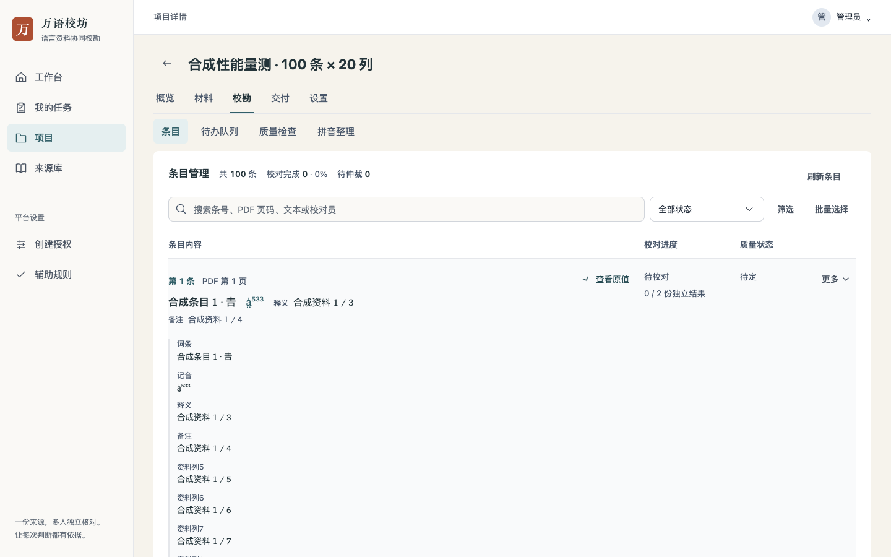

# UI 性能优化验收

优化基线为UI精修提交 `f3834f5`。本轮不增加依赖，不改后端接口、数据库、授权、任务状态或字库资产。分支 `feat/ui-refinement-20261108` 同时包含UI精修与本轮性能改动。

## 生产构建量测

使用同一版本Microsoft Edge、1440×900视口和相同100条×20列合成数据，每组5次新浏览器上下文。静态资源经本机路由提供，API连接真实临时后端；没有网络节流。数据集SHA-256一致，DOM计数每次一致。耗时为本机观察，包含资源/接口读取及渲染，不是线上Web Vitals，也不设不稳定的CI耗时门槛。

| 初始状态 | 优化前 | 优化后 |
| --- | ---: | ---: |
| 列表DOM元素 | 12,639 | 4,239（减少66.46%） |
| 字段值节点 | 2,500 | 400（减少84%） |
| 收起原值内的字段值节点 | 2,100 | 0 |
| 整页DOM元素 | 12,762 | 4,362 |
| 初始渲染中位耗时（本机） | 994.8ms | 852.5ms |
| 首次展开中位耗时（本机） | 40.5ms | 40.1ms |

首次打开某条原值时只创建该条的21个值节点，而不是预先创建全部100条。首次打开承接延后的创建工作，关闭后不销毁内容，重复展开仍为同一DOM，20列Unicode、空白和原文全部核对。首次展开中位差异只有0.4ms，属于本机波动，不据此宣称展开更快。完整耗时分布见[优化前](baseline.json)、[最终构建](after.json)；[汇总](summary.json)记录源码、产物和回执摘要。




## 实现与边界

- `AppDisclosure lazy` 为可选能力，只让原值与字符说明首次展开后再创建内容；ARIA容器始终存在，默认/受控展开立即可用，已打开内容的DOM、焦点和选区保留。来源阻塞区仍即时挂载。字符键盘入口与全部字符保留。
- 列表共享当前项目/账号的授权列角色对象，100条重算从300次JSON解析、100次相同角色序列化降为200次解析、0次角色序列化；不缓存过期条目或跨账号数据。见[纯函数回执](entry-computation.json)，其中Node耗时不代替浏览器结果。
- 聚合字体输入为稳定computed；相同字符集合不重复启动字体API检查或闪回加载态。5个字符、10次等价文本更新的检查次数55→5；这是API调用数，不是下载次数。新增字、显式重试、失败状态和迟到结果保护继续工作。
- 字体检测将3858段相邻覆盖在初始化时合并为11段，只改变查找工作量，不改变码位、覆盖、字体优先级或原字符串。单测核对全部 `0..0x10FFFF` 码点；[字体微基准](font-performance.json)为Node参考值。
- 普通输入在更新模型后只执行一次尺寸计算，原稳定宽度场景的高度读取2→1。模型、change与草稿立即更新；组合预编辑仍增高，组合结束或取消回相同值也恢复正确高度。合成composition事件回归通过，不冒充原生输入法验收。

## 回归与复跑

- 最终 `make check` 通过，490项前端单测、Go全包、格式/静态守卫、迁移与Compose检查通过。
- `run_frontend_quality_browser.py --only components workbench editor review fonts unicode` 通过，共19个实际脚本入口，使用真实临时后端与浏览器拦截夹具。
- 最后补充的IME取消场景已独立复跑 `editor-experience.cjs`，确认普通输入、预编辑、提交、取消、精确字符、跨断点与未核实仲裁门槛。
- 原值首开/重开、批量操作不重复字体检查、列角色失败/重试、Unicode与空白、默认/受控展开、ARIA、inert、焦点、字符键盘及只读回看均保留原覆盖。
- 独立复核确认字体区间和集合去重无新的保真/异步问题，发现的IME取消后高度未恢复已修复并加入回归。

本机可复跑生产基准（先保全 `f3834f5` 的生产构建到 `$WANYU_BASELINE_DIST`，不要覆盖该基线）：

```sh
VITE_PB_URL=http://localhost npm --prefix frontend run build
NODE_PATH=/path/to/playwright/node_modules BROWSER_CHANNEL=msedge \
  python3 frontend/tests/browser/run-ui-performance.py --dist "$WANYU_BASELINE_DIST" --label baseline
NODE_PATH=/path/to/playwright/node_modules BROWSER_CHANNEL=msedge \
  python3 frontend/tests/browser/run-ui-performance.py --dist frontend/dist --label after
node frontend/scripts/benchmark-font-performance.mjs f3834f5
```

基准脚本是按需本机工具，不进入默认CI，不安装额外依赖、不访问生产或外站，临时后端退出后删除。原生iOS/Android键盘与输入法、真实读屏、200%原生缩放和真人试用仍待验；远端CI应以创建PR后实际运行结果为准。本轮没有部署或合并。

实现、自动化量测与独立复核由OpenAI Codex完成。
