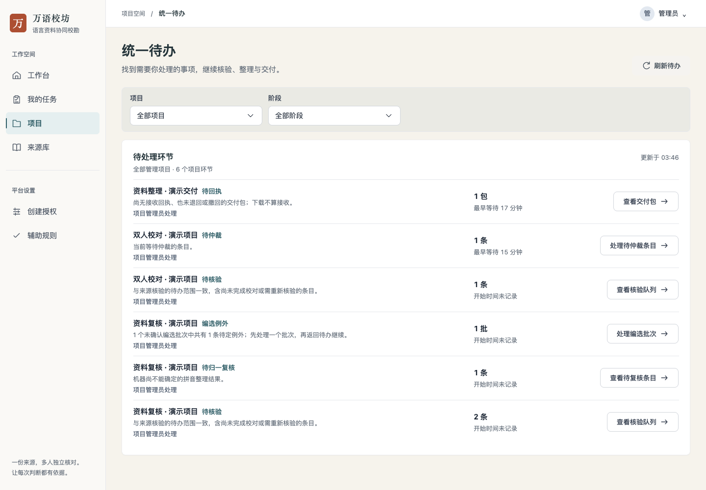
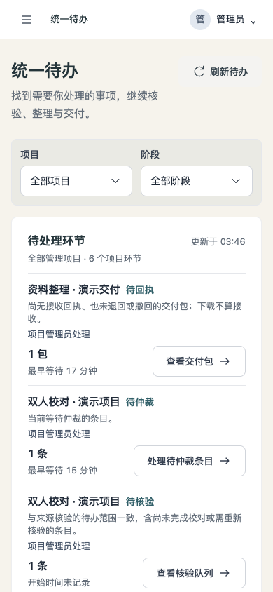
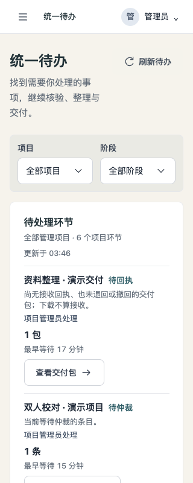
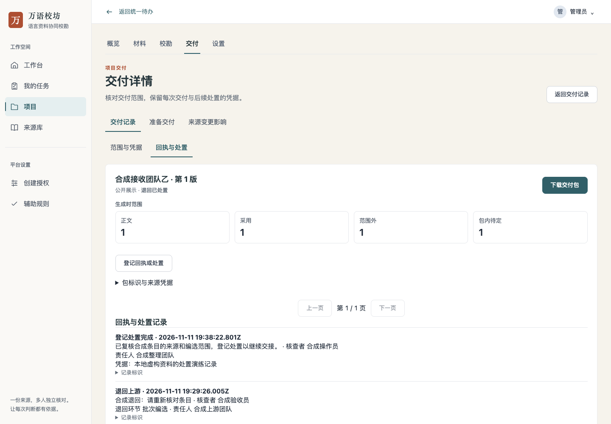
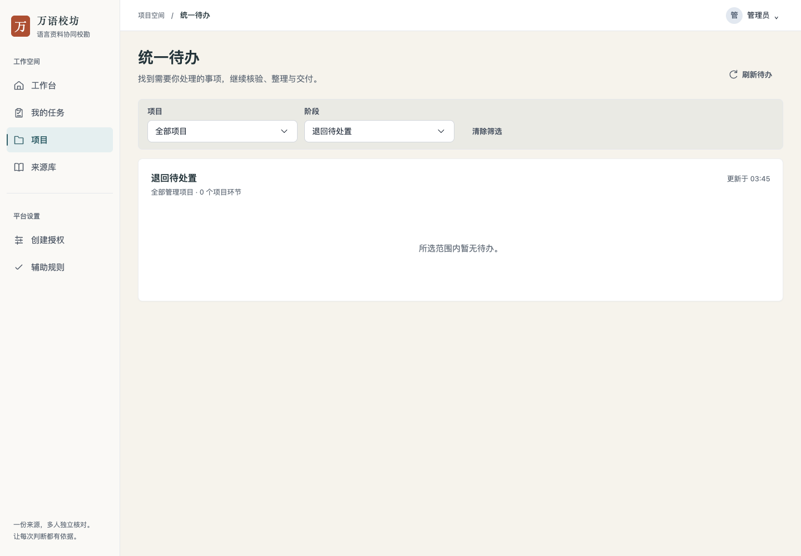
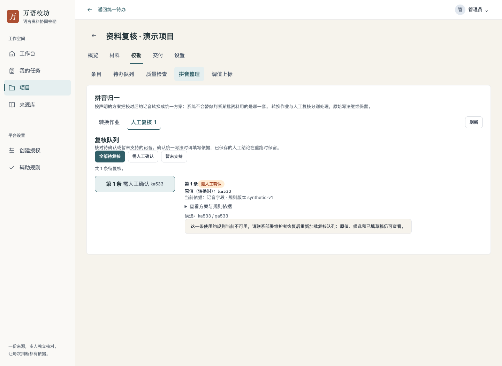
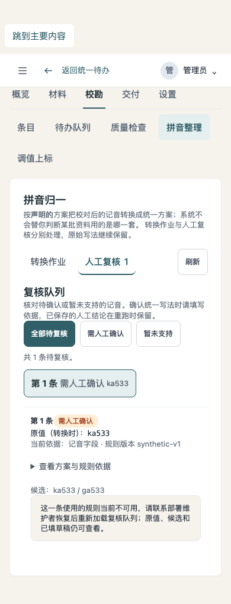
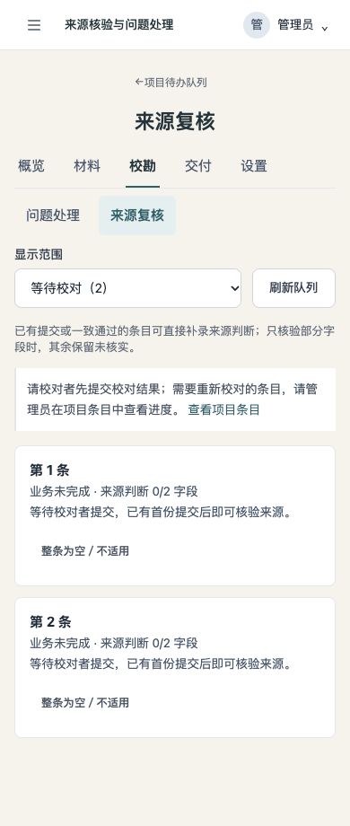

# 统一待办界面与操作记录

日期：2026-11-12。隔离本地后端、真实浏览器操作，所有账号、资料、接收方与处置说明均为虚构演示内容。没有修改生产项目，也没有将浏览器演示当作真人用户正式验收。

## 已走通的使用过程

- 从工作台打开统一待办，筛项目/阶段，直接定位来源问题；填写具体原因、修复方式和影响范围后保存，返回原筛选，该组待办消失。首次操作发现必填条件不够明显，已在对应字段标明。
- 从统一待办打开具体仲裁条目，进入编选例外和来源核验的既有页面；回程保留项目与阶段。交付详情切换标签、刷新和浏览器后退后仍能返回原待办范围。
- 实际填写并保存一条退回处置凭据，返回后保留 `退回待处置` 筛选并显示暂无待办。重新打开该历史包显示“退回已处置”，不继续显示等待回执，也不将处置记为接收成功。另一个真正待回执包仍正常显示等待时间。
- 退回历史使用“退回环节：批次编选”等中文名称；出包时的范围标明“生成时范围”和“包内待定”，与当前待处理工作区分。
- 失效项目链接提示不可用，清除筛选后可以继续查看其他管理项目；无效阶段不无声扩大范围。错误信息与空列表分别呈现。
- 来源复核只将可进入核验或仲裁的条目列入待办；无首次校对提交的条目在“等待校对”范围显示下一步，并保留空记录确认入口。
- 归一复核在无规则实例仍显示原值、候选和阻塞说明，返回保留原项目与阶段。在另一套带合成规则的隔离实例中，实际填写并保存人工结论后，条目变为已复核。仅测试规则仍不能发起正式转换。

## 最终界面

桌面 1440px、手机 390px 与窄屏 320px 已打开截图目检。主操作、数量单位和筛选可见，保持现有纸墨界面，无整页横向溢出。

截图中来源问题和退回事项已在本次操作中关闭，所以最终全阶段列表不再列出这两组；入口支持的工序不因此减少。

## 待办前置条件与继续操作

以下截图来自后续两套独立的合成实例，分别查看无规则时的复核队列与等待校对范围。历史截图反映此前待办范围，当前来源计数以可打开核验或仲裁的条目为准。

## 必要检查与限制

前端 lint、build、相关 Node 检查及 UI 债务检查通过；后端通过当前待办、交付状态与实际接口的针对性检查。`git diff --check` 通过。尝试执行 `make check` 时本机缺少 PyYAML，停在该前置依赖；未将其记为全量通过，也没有为此扩展环境安装或专项测试。完整门禁仍由 CI 执行。

归一操作使用合成规则和虚构记音，只确认界面与人工保存流程，不代表真实语言方案可用或转换准确率。没有进行生产部署、真实语言质量评估或真实接收方验收。下一步应由实际项目管理员用真实获准资料试用，观察能否无需解释找到事项并完成一次交接。
