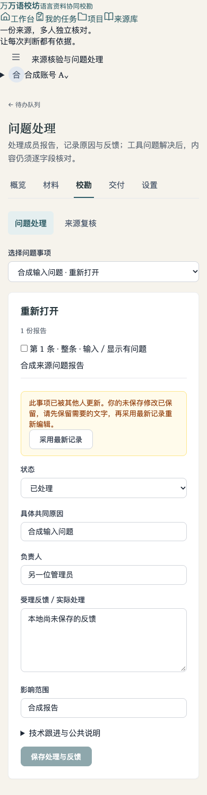

# PR #389 CI 与评审修复（2026-11-08）

修复基于 `6fd7e63de0bf2a7193fbddeb7abbcc0cfd38dbe6`。原先唯一失败的业务检查为 [Source verification progress and excluded-task browser regression](https://github.com/e-dialect/wanyu-proofreader/actions/runs/42366305839/job/128385004915)，在问题列表读取完成前断言数量，得到 `0 !== 2`；CI gate 随之失败。

## 评审意见与结果

- 两处空列表明确传入 `reason="none"`。无成员报告、无来源复核条目和筛选后为空均保留工作区与导航。
- 问题表单保留独立读取基线。未修改表单同步服务器最新字段；同版本的未保存草稿保留。服务器版本变化时保留草稿、显示冲突并阻止按钮和原生表单提交；采用最新记录后重新编辑。保存成功更新基线，保存期间追加输入不丢失。
- 真实后端浏览器测试等待问题列表、我的问题列表完成渲染，再执行原有数量断言，未放宽业务条件。

## 验证

- `make verify-static` 和 `make test lint verify-versions verify-migrations verify-compose`：覆盖完整 `make check` 门禁，含 470 项前端测试、Go 全包、ESLint、格式、31 项迁移 up/down/up、仓库与 Compose 守卫。
- `npm --prefix frontend run build`：生产构建通过。
- `python3 backend/tests/run_frontend_quality_browser.py --only repository`：既有仓库回归、归一草稿回归和新增来源工作区回归通过。
- `FIDELITY_BROWSER_SCRIPT="$PWD/backend/tests/source_fidelity_browser.cjs" FIDELITY_BROWSER_FIXTURE=/tmp/pr389-source-fixture.json python3 backend/tests/run_integration.py source_fidelity_integration.mjs --env FANGJI_RESEARCH_MODE=1`：完整迁移的临时数据库、真实后端与生产 UI 浏览器集成通过。

浏览器命令需要已安装 Playwright，可用 `NODE_PATH` 指向依赖目录；macOS 使用已安装的 Edge（`BROWSER_CHANNEL=msedge`）。新增套件已纳入现有 CI 的统一 runner，无需另设执行入口。全部账号、报告和材料为合成数据。

新增浏览器覆盖的 11 项检查见 [运行报告](pr389-source-fidelity-regression.json)。390px 冲突截图经目视检查，提示、保留的草稿、采用最新记录按钮和禁用保存按钮均正常显示，无整页水平溢出。

这里验证的是重新读取时发现版本变化后的草稿处理。后端现有写入接口未新增原子版本条件，不将此修复表述为所有并发写入的事务保护；原生输入法、真人和读屏验收仍以 PR 原有待验项为准。本次未部署生产。
