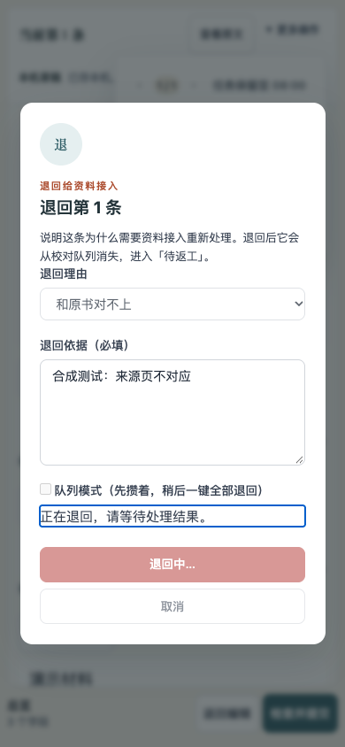
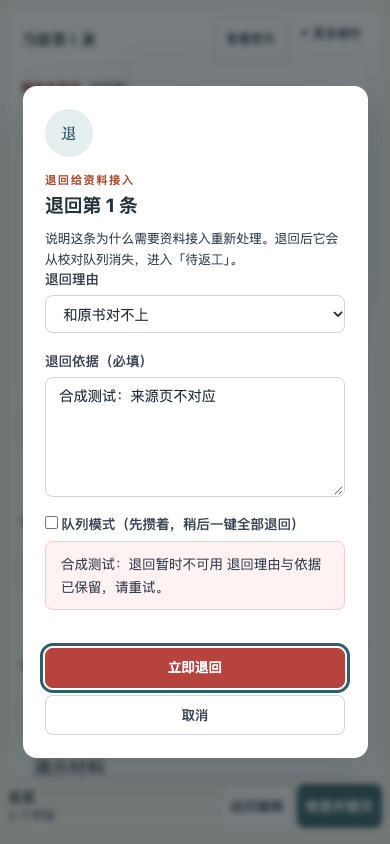

# 校对退回等待与重试

Chrome 通过仓内校对工作台加载合成条目。测试拦截退回请求，先延迟响应并返回 HTTP 503，再接受同一理由和依据的重试。截图采用 390 × 844 视口。

| 等待退回结果 | 失败后保留依据并聚焦「立即退回」 |
| --- | --- |
|  |  |

`frontend/tests/browser/editor-keyboard-flow.cjs` 在主分支 `9958675` 的独立服务上报出 `Escape dismissed a pending return`。修复后的 1280、1440、390 三种视口均通过了等待时的 Esc、遮罩、Tab、Shift+Tab、失败重试、成功进入下一条及空闲 Esc 关闭回焦检查。1440 视口还覆盖两项队列中一项失败，只重试该项并在完成后关闭。共用确认框的桌面和手机模拟视口通过 `frontend/tests/browser/modal.cjs` 检查。

这些截图记录自动浏览器结果。真实设备和志愿者的完整键盘走查仍由 #265 跟踪。
